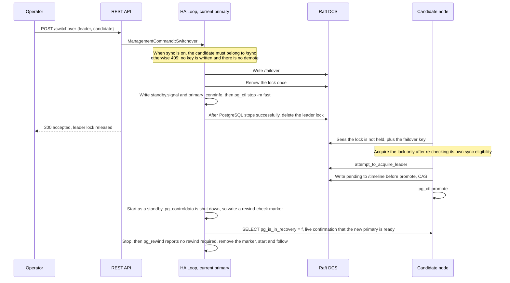
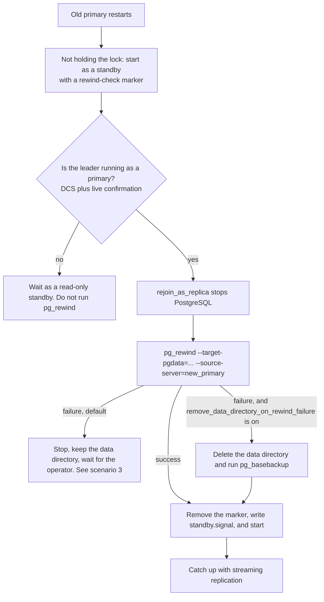

# pg-ha operations guide

[中文](../operations-guide.md)

## Cluster status checks

### Cluster overview

```bash
# Cluster topology: each member's role and replication upstream (not the full member object)
curl -s http://localhost:8008/cluster | jq .
```

The response comes from `CascadeManager::build_cascade_topology`. Roles are lowercase (`primary` / `replica` / `standby_leader`). The primary has no `upstream`. A replica with `tags.replicatefrom` gets an extra `replicatefrom` field; when the upstream is unhealthy, `upstream` falls back to the current leader.

```json
{
  "scope": "prod-cluster",
  "members": [
    {"name": "node1", "role": "primary", "upstream": null},
    {"name": "node2", "role": "replica", "upstream": "node1"},
    {"name": "node3", "role": "replica", "upstream": "node1"}
  ]
}
```

A node's own runtime state, timeline, WAL, lag, pause, and pending-restart flags are on **this node's** `/patroni`, not in `/cluster`:

```bash
curl -s http://localhost:8008/patroni | jq .
```

```json
{
  "state": "Running",
  "role": "Primary",
  "scope": "prod-cluster",
  "name": "node1",
  "timeline": 1,
  "wal_position": 12345678,
  "replication_lag": 0,
  "paused": false,
  "pending_restart": false,
  "tags": {}
}
```

`timeline`, `wal_position`, and `replication_lag` are updated by the HA loop every cycle. `replication_lag` (bytes) = the leader's last published `wal_position` minus this node's `wal_position`, with a minimum of 0; the primary is 0. It is `null` (unknown, not 0) when a replica has no leader record, a position is missing on either side, or PostgreSQL is not running. `timeline` is likewise `null` when PostgreSQL is not running. Note: the leader's position is refreshed only once per `loop_wait`, so under a heavy write load the lag reads low, short by at most about one `loop_wait` of WAL. It measures WAL the replica has **received** (`max(receive, replay)`), not WAL that has been applied.

The `role` / `state` on `/patroni` use Rust Debug formatting (`Primary`, `Replica`, `Running`), which is not the same set of strings as the lowercase roles on `/cluster`.

Health checks (`/primary`, `/replica`, `/health`, `/liveness`, `/sync`, `/async`, `/cluster`, `/patroni`, `/metrics`, `/history`) do not require authentication. `/switchover`, `/failover`, `/restart`, `/reinitialize`, and `/config` require HTTP Basic Auth when `restapi.username` is set in the YAML. The Docker entrypoint defaults to username `admin` and password `secret`.

> **TLS / HTTPS**: The examples below use `http://`, which is the REST API's default cleartext form. After `restapi.tls` (`cert` + `key`) is configured, the REST API switches to HTTPS. In every example, replace `http://` with `https://` and supply the trust root with `--cacert <ca.crt>`. When mTLS is on (`require_client_cert: true`), also pass `--cert <client.crt> --key <client.key>`. Proxy probes of `/primary` and `/replica` use the same material: on HTTPS they trust `ca_cert`, and on mTLS they present this node's own server certificate. **Basic Auth credentials are protected in transit only after TLS is enabled** — on cleartext HTTP, credentials and management commands are both sent in the clear. In production, enable TLS for the REST API (see "REST API TLS / mTLS" in the deployment guide).

### Primary check

```bash
# 200 means this node is the Primary and holds the leader lock
curl -s -o /dev/null -w "%{http_code}" http://localhost:8008/primary
# 200 → Primary, 503 → not the Primary

# With details
curl -s http://localhost:8008/primary | jq .
```

### Replica check

```bash
# 200 means this node is a healthy replica
curl -s -o /dev/null -w "%{http_code}" http://localhost:8008/replica
# 200 → healthy replica, 503 → not a replica, or unhealthy

# Lag-threshold check (unit: bytes)
curl -s http://localhost:8008/replica?lag=1048576 | jq .
# Returns 503 when the known lag exceeds 1MB
# When lag is unknown (no leader record, or a position is missing, such as during failover) it still returns 200, with "lag": null in the response (fail-open)
```

### Synchronous / asynchronous standby checks

Once synchronous replication is enabled, the following endpoints distinguish a synchronous standby from an asynchronous standby (based on the DCS `/sync` list):

```bash
# Synchronous standby: a healthy replica that is on the /sync.sync_standby list → 200
curl -s -o /dev/null -w "%{http_code}" http://localhost:8008/sync
# Alias: /synchronous

# Asynchronous standby: a healthy replica that is not on the sync list → 200
curl -s -o /dev/null -w "%{http_code}" http://localhost:8008/async
# Alias: /asynchronous
```

When synchronous replication is not enabled, or `/sync` is empty: every healthy replica returns 200 for `/async` and 503 for `/sync`. The primary returns 503 for both.

### Health checks

```bash
# Whether PostgreSQL is running
curl -s http://localhost:8008/health | jq .

# Liveness (whether the HA loop has run within the TTL)
curl -s -o /dev/null -w "%{http_code}" http://localhost:8008/liveness

# Full node state
curl -s http://localhost:8008/patroni | jq .
```

### Prometheus metrics

```bash
curl -s http://localhost:8008/metrics
```

Output (when the values of `pg_ha_replication_lag_bytes` and `pg_ha_timeline` are unknown, the corresponding sample lines are omitted and only the HELP/TYPE lines are kept: there is no timeline when PostgreSQL is not running, and there is no lag when a replica has no leader record or a position is missing):

```
# HELP pg_ha_node_role Current role of this node
# TYPE pg_ha_node_role gauge
pg_ha_node_role{role="primary"} 1
# HELP pg_ha_pg_state Current PostgreSQL state (1 = active for the labeled state)
# TYPE pg_ha_pg_state gauge
pg_ha_pg_state{state="running"} 1
# HELP pg_ha_replication_lag_bytes Replication lag in bytes
# TYPE pg_ha_replication_lag_bytes gauge
pg_ha_replication_lag_bytes 0
# HELP pg_ha_timeline Current PostgreSQL timeline
# TYPE pg_ha_timeline gauge
pg_ha_timeline 1
# HELP pg_ha_dcs_last_seen_seconds Seconds since last successful DCS communication
# TYPE pg_ha_dcs_last_seen_seconds gauge
pg_ha_dcs_last_seen_seconds 2.345
# HELP pg_ha_pending_restart Whether a PostgreSQL restart is pending (1 = pending)
# TYPE pg_ha_pending_restart gauge
pg_ha_pending_restart 0
# HELP pg_ha_is_paused Whether the cluster is in pause mode (1 = paused)
# TYPE pg_ha_is_paused gauge
pg_ha_is_paused 0
```

Failsafe does not apply under pg-ha's embedded RaftDcs and has been removed (SB-04 NO-GO), so there is no `pg_ha_failsafe_active` metric. Cases where consensus cannot be reached are handled by lease-expiry fencing (see [invariants.md](invariants.md) L5 / "Lease-expiry fencing"). See [TODO #4](TODO.md).

---

## Manual switchover

A switchover is a planned primary/standby switch that does not lose data. It requires the current primary to be healthy and reachable.

> ⚠️ **Synchronous replication**: If `synchronous_mode` is enabled, the specified `candidate` must be on the current DCS `/sync.sync_standby` list; otherwise the response is **409** (no demote, and the failover key is not written). Confirm the candidate first with each node's `GET /sync` (200 = a healthy replica that is on the list). See "Synchronous replication" below.

```bash
# Specify the leader and the candidate
curl -u admin:secret -X POST http://localhost:8008/switchover \
  -H 'Content-Type: application/json' \
  -d '{"leader": "node1", "candidate": "node2"}'

# No candidate specified (pick the healthiest running member other than this node; this node does not stand.
# When sync is on, the successor must still be on the /sync list. 409 when there is no eligible successor, and no demotion)
curl -u admin:secret -X POST http://localhost:8008/switchover \
  -H 'Content-Type: application/json' \
  -d '{"leader": "node1"}'

# scheduled_at is not yet implemented: a request that includes this field gets 409 rejected (do not rely on it being "scheduled")
curl -u admin:secret -X POST http://localhost:8008/switchover \
  -H 'Content-Type: application/json' \
  -d '{"leader": "node1", "candidate": "node2", "scheduled_at": "2026-10-17T01:00:00Z"}'
```

Response of an immediate switchover:

```json
{"status": "accepted", "message": "Switchover initiated, leader lock released"}
```

With `scheduled_at`, the response is HTTP 409 and `message` contains `scheduled switchover is not implemented`. `status` is always lowercase: `accepted`, `rejected`, `error`. An ineligible candidate (sync is on and the candidate is not in `/sync`) returns HTTP 409:

```json
{"status": "rejected", "message": "Candidate 'node3' is not a synchronous standby (sync mode requires /sync membership)"}
```

A candidate that does not exist, has `nofailover`, or is not Running is also 409. A candidate that carries a rewind-check marker (`pg-ha.rewind_check`, not yet verified with pg_rewind) is also 409, and the same applies to `POST /failover`:

```json
{"status": "rejected", "message": "Candidate 'node2' has a rewind-check marker (not yet verified with pg_rewind)"}
```

After the request is accepted, if the candidate cannot take part in the election under [invariants.md](invariants.md) 1a "D6" (for example it is not on the latest timeline), other nodes log WARN `Designated candidate <c> may not take part in the election (it is not shown to be on the latest timeline); proceeding as if no candidate were designated` and elect as if no candidate had been designated: the `leader` in `/failover` is still excluded, and the lock is not given back to the old primary that just stepped down.

When no candidate is specified, and aside from this node there is no member that is running, allowed to fail over, and (when sync is on) a member of `/sync`, the response is 409. `/failover` is not written, and PostgreSQL is not stopped:

```json
{"status": "rejected", "message": "No other running member can take over; refusing switchover without a candidate"}
```

**Cancel a scheduled switchover:** `DELETE /switchover` can still clear a leftover `pending_switchover` in this process (a historical field). Scheduled switchover is not implemented; do not rely on it in production.

**What an immediate switchover does on the node that initiates it** (it does not run CHECKPOINT first; CHECKPOINT runs only on the shutdown path, when the process receives SIGTERM/SIGINT):

1. Validate the candidate (it exists, is Running, is not nofailover, has no rewind marker, and meets the synchronous-replication eligibility check). If writing `/failover` fails, abort and return an error, without stopping PostgreSQL
2. Write `{leader, candidate}` to DCS `/failover`
3. Renew the leader lock once (the HA loop does not run while the command executes). If renewal fails, fence according to lease expiry and return the error `Switchover aborted: leader lock renewal failed; ...`
4. Write `standby.signal` and fsync it. When there is a candidate, point `primary_conninfo` in `postgresql.auto.conf` at the candidate; when there is not, delete `primary_conninfo`. Other settings in `postgresql.auto.conf` are kept
5. `pg_ctl stop -m fast`, and change the role to Replica
6. Delete this node's leader lock only after confirming that PostgreSQL has stopped. If the stop fails, the lock is left in place and the response is the error `Switchover initiated, but stopping PostgreSQL failed: ...; pg-ha keeps fencing it and holds the leader lock`. After that, every round renews the lock and retries the stop (see "Switchover stuck" below). If deleting the lock fails, the lock is also left in place and PostgreSQL is not started (`Not starting PostgreSQL: the leader lock may still be ours ...`). The next round retries the delete. PostgreSQL is started as a standby only after it is confirmed that the lock is no longer ours



**Rewind check of the old primary after a switchover**: After the old primary's `pg_ctl stop -m fast`, `pg_controldata` reports `shut down`. On the next start, a rewind-check marker is written according to the startup rules. Logs:

```text
Created rewind-check marker: pg_controldata reports 'shut down' (last ran as a primary)
Starting PostgreSQL as a standby (not holding the leader lock)
```

After the new primary is seen to be ready:

```text
Rewind-check marker present and <new> holds the leader lock — checking with pg_rewind before following
Running pg_rewind to resync from current primary
pg_rewind succeeded; removed the rewind-check marker
```

A normal switchover has no divergence, and pg_rewind reports `no rewind required`. So after every switchover the old primary does one extra pass of "start as a standby → stop → pg_rewind → start again", and during that window it is briefly unavailable for read-only traffic. Until this check finishes, a reverse switchover / failover that names the old primary as the candidate is rejected (409, `Candidate '<old>' has a rewind-check marker (not yet verified with pg_rewind)`). Send it again after the log shows `pg_rewind succeeded`.

> **Credential source (SB-07)**: Both `pg_rewind` and the pre-rewind `psql` liveness probe must connect to the current primary **as a superuser**. A member's `conn_url` **contains no password** (only host/port/dbname/user; the password is not stored in the DCS). These commands take the password from this node's **local** `postgresql.superuser.password` and pass it to the child process through `PGPASSWORD`. Therefore **every node's `postgresql.superuser.password` must match the other nodes in the cluster** (the same cluster superuser); otherwise rewind / the probe cannot connect to the peer primary. Connection strings in the logs are redacted by `redact_connstr` to `password=***`. The password does not appear in command-line arguments or on disk. When the password is empty, `PGPASSWORD` is not set (equivalent to trust/peer/ident authentication).

---

## Manual failover

Failover is the emergency switch used when the primary is unreachable. The current primary does not need to take part.

> ⚠️ **Synchronous replication**: When `synchronous_mode` is enabled, a specified `candidate` must likewise belong to the `/sync` list; otherwise **409**. When no candidate is specified, after the election request is written only nodes on the list acquire the lock. If the list is empty, the cluster may have no primary for a long time (acknowledged transactions are preserved). See "Synchronous replication".

```bash
# Specify a candidate
curl -u admin:secret -X POST http://localhost:8008/failover \
  -H 'Content-Type: application/json' \
  -d '{"candidate": "node2"}'

# No candidate specified (pick the healthiest node; when sync is on, still constrained by /sync)
curl -u admin:secret -X POST http://localhost:8008/failover \
  -H 'Content-Type: application/json' \
  -d '{}'
```

Response (HTTP 200):

```json
{"status": "accepted", "message": "Failover request submitted"}
```

> ⚠️ **Note**:
> - **Sync off**: Failover may lose WAL that has not yet been replicated to a replica. Prefer a switchover when the primary is still reachable.
> - **Sync on**: When switching to a node on the `/sync` list, commits already acknowledged to the client should still be on the new primary. If the list is empty or the candidate is ineligible, the system would rather not switch than promote an asynchronous replica for the sake of availability.

### TTL of the `/failover` key (intent lifetime, SB-05)

Switchover / failover write the intent into the DCS `/failover` key. On the normal path, after someone acquires the leader lock this key is cleared (written as an empty string). But if the designated candidate dies before acquiring the lock, or disappears from the member list after the write, that clear step never runs. In the old implementation this key had no TTL and stayed **permanently**. Other nodes kept yielding to a candidate that could never take the lock — the cluster could remain without a primary even though Raft still had a majority. A manual intent issued in a healthy cluster would also linger until some later election resurrected it.

From SB-05, the `/failover` key reuses the cluster's **`ttl`** (the same TTL as the leader lease, default 30s, changing with the dynamic `ttl` from `PATCH /config`; **it is not a new configuration item**):

- A **non-empty** intent is valid for at most about `ttl` seconds. If the designated candidate does not take over within this window, the key expires and disappears on its own, and the cluster returns to a normal "whoever is healthiest" election. A dead candidate can no longer leave the cluster without a primary forever.
- The **clear** semantics are unchanged: writing an empty string after a successful lock acquisition still clears the key (an empty value carries no TTL, and reading it back does not parse it as an intent).
- Because scheduled switchover is not implemented (`scheduled_at` is always 409), `/failover` carries only "immediate" intents, and a short TTL does not risk cutting off a future plan.

So after a switchover / failover is issued, if the expected switch does not happen within about `ttl` seconds (for example the candidate is down), there is no need to clear the key by hand — it expires on its own, and the cluster then elects a primary normally.

---

## Dynamic configuration changes

Dynamic configuration is stored in the DCS `/config` key. Every node detects and applies changes automatically on each HA cycle.

### Read the current configuration

```bash
curl -u admin:secret http://localhost:8008/config | jq .
```

### Partial update (PATCH)

```bash
# Change loop_wait and ttl (the result must satisfy "HA timing-parameter constraints" below; otherwise 400 is returned and nothing is written)
curl -u admin:secret -X PATCH http://localhost:8008/config \
  -H 'Content-Type: application/json' \
  -d '{
    "loop_wait": 15,
    "ttl": 45
  }'

# Change PG parameters (ones that need a reload)
curl -u admin:secret -X PATCH http://localhost:8008/config \
  -H 'Content-Type: application/json' \
  -d '{
    "postgresql": {
      "parameters": {
        "work_mem": "128MB",
        "effective_cache_size": "8GB"
      }
    }
  }'

# Delete a configuration item (set it to null)
curl -u admin:secret -X PATCH http://localhost:8008/config \
  -H 'Content-Type: application/json' \
  -d '{
    "maximum_lag_on_failover": null
  }'

# Enable pause mode (stop automatic failover)
curl -u admin:secret -X PATCH http://localhost:8008/config \
  -H 'Content-Type: application/json' \
  -d '{"pause": true}'

# Disable pause mode
curl -u admin:secret -X PATCH http://localhost:8008/config \
  -H 'Content-Type: application/json' \
  -d '{"pause": false}'

# Enable synchronous replication (off by default)
curl -u admin:secret -X PATCH http://localhost:8008/config \
  -H 'Content-Type: application/json' \
  -d '{
    "synchronous_mode": true,
    "synchronous_mode_strict": false,
    "synchronous_node_count": 1
  }'

# Disable synchronous replication
curl -u admin:secret -X PATCH http://localhost:8008/config \
  -H 'Content-Type: application/json' \
  -d '{"synchronous_mode": false}'
```

### Full replacement (PUT)

```bash
curl -u admin:secret -X PUT http://localhost:8008/config \
  -H 'Content-Type: application/json' \
  -d '{
    "loop_wait": 10,
    "ttl": 30,
    "retry_timeout": 10,
    "maximum_lag_on_failover": 1048576,
    "postgresql": {
      "parameters": {
        "work_mem": "64MB",
        "max_connections": "200"
      }
    }
  }'
```

### How configuration changes take effect

| Parameter type | How it takes effect | Example |
|---------|---------|------|
| HA parameters | Applied immediately on the next cycle | `loop_wait`, `ttl`, `pause` |
| Synchronous-replication parameters | On the primary's next cycle: change PG and write DCS `/sync` (two phases) | `synchronous_mode`, `synchronous_mode_strict`, `synchronous_node_count`, `maximum_lag_on_syncnode` |
| PG reload parameters | `pg_ctl reload` runs automatically | `work_mem`, `effective_cache_size` |
| PG restart parameters | Set the `pending_restart` flag; do not restart automatically | `max_connections`, `shared_buffers`, `wal_level`, `max_wal_senders` |
| `failsafe_mode` | Kept for backward compatibility, but a **no-op** (failsafe does not apply under RaftDcs, SB-04 NO-GO) | See [TODO #4](TODO.md) |
| `standby_cluster` | Next cycle: the node holding the lock switches to following the remote | See "Standby cluster" below |

For a parameter that requires a restart, run this by hand:

```bash
curl -u admin:secret -X POST http://localhost:8008/restart
```

On the node that holds the lock, PostgreSQL restarts in its original role. On a node that does not hold the lock, pg-ha first prepares according to the startup rules (writes `standby.signal`, and writes a rewind-check marker when `pg_controldata` shows that it last ran as a primary), then stops PostgreSQL and starts it as a standby. If preparation fails, it returns the error `Not restarting PostgreSQL: standby configuration could not be written: ...` and PostgreSQL is left untouched (see [invariants.md](invariants.md) 1a "Startup rules").

### HA timing-parameter constraints

`ttl`, `loop_wait`, `retry_timeout`, and `watchdog.safety_margin` must satisfy:

```text
ttl >= loop_wait + retry_timeout + watchdog.safety_margin, and retry_timeout >= 1
```

Reason: if the lock holder has not successfully renewed again within `ttl` − `safety_margin` seconds of the moment **before** the last renewal **started**, it stops PostgreSQL itself (the leader lease; see [invariants.md](invariants.md) 1a "Leader lease"). A healthy primary must finish one HA cycle (`loop_wait`) and one renewal write (each DCS write waits at most `retry_timeout` seconds) inside that window. The defaults satisfy 30 ≥ 10 + 10 + 5; the docker development cluster satisfies 15 ≥ 5 + 5 + 5.

- When static configuration (`pg-ha.yml`, environment-variable overrides, `bootstrap.dcs`) does not satisfy this, pg-ha refuses to start, and `--validate-config` reports the same error:
  ```text
  Error: Configuration error: ttl (20) must be >= loop_wait (10) + retry_timeout (6) + watchdog.safety_margin (5) = 21: ...
  ```
  When `bootstrap.dcs` does not satisfy it, the error begins with `bootstrap.dcs:`.
- When `PATCH` / `PUT /config` changes `ttl`, `loop_wait`, or `retry_timeout` and the result does not satisfy the constraint, the response is 400 and the configuration is not written:
  ```json
  {"error": "Rejected, configuration not changed: ttl (15) must be >= loop_wait (6) + retry_timeout (5) + watchdog.safety_margin (5) = 16: ..."}
  ```
  Items absent from the dynamic configuration are computed from the static values of the node that receives the request. `safety_margin` exists only as a static value. A request that does not change these three items is not checked.
- A dynamic change to `ttl` / `retry_timeout` takes effect immediately: both the TTL written into the lock and the DCS-write timeout are read from atomic variables, and `PATCH` / `PUT /config` updates them as soon as validation passes (`RaftDcs::set_lock_timing`). No restart is required. Before increasing `loop_wait`, still confirm that `ttl >= loop_wait + retry_timeout + safety_margin` holds (otherwise the response is 400 and the configuration is not written).

**Old primary under a partition**: After the lock holder loses contact with the majority, it stops PostgreSQL at the latest `ttl − safety_margin` seconds after the last renewal started (default 25 seconds, docker 10 seconds), whether or not the DCS call returns. The majority can acquire the lock at the earliest `ttl` seconds later. This assumes wall-clock skew between nodes is less than `safety_margin`. There is no fencing while paused. Related logs:

| Log | Meaning |
|------|------|
| WARN `DCS write timed out after <n>s (retry_timeout); treating it as failed` | A DCS write did not finish within `retry_timeout` (for example this node is the Raft leader that lost the majority) and is treated as a failed write. The write may still commit afterward; that is safe ([invariants.md](invariants.md) 1a) |
| ERROR `Leader lease expired before the lock renewal completed; fencing PostgreSQL (immediate stop) without waiting for the DCS` | The lease expired, this HA cycle is abandoned, and PostgreSQL is stopped in `immediate` mode |
| ERROR `Leader lease expired before pg_ctl promote; fencing PostgreSQL (immediate stop)` / `Leader lease expired before reporting the leader role; fencing PostgreSQL (immediate stop)` | Renewal returned success, but the lease had already expired by the time it returned (the renewal write was too slow). Do not promote, do not report the primary role, and fence as if the lock had been lost |
| ERROR `Leader lease already expired at shutdown; skipping drain, CHECKPOINT and lock release, fencing PostgreSQL (immediate stop)` | The lease had already expired at shutdown; fence and stop PostgreSQL directly |
| ERROR `Leader lease expired before CHECKPOINT and the PostgreSQL stop finished during shutdown; fencing PostgreSQL (immediate stop) and keeping the leader lock` | Shutdown finalization (CHECKPOINT plus the stop) did not finish within the lease of the last renewal. Fence and stop PostgreSQL, and do not release the lock |
| INFO `Created rewind-check marker: leader lease expired before renewal` | `standby.signal` and a rewind-check marker were written before the fencing stop. Afterward it starts as a standby according to the startup rules, and runs pg_rewind first after seeing the new leader |

If lease fencing appears in a healthy cluster, PostgreSQL or the DCS is usually too slow for one renewal to finish within `ttl − safety_margin`. `ttl` can be increased.

---

## Synchronous replication

### How it works

With PostgreSQL asynchronous replication, the primary returns success to the client immediately after COMMIT, without waiting for any replica to acknowledge. If the primary crashes at that moment, acknowledged transactions from the last few seconds may be lost.

Synchronous replication changes that behavior: on COMMIT, the primary **must wait until at least N synchronous standbys have acknowledged receipt of the WAL** before it returns "success" to the client. This guarantees that a transaction for which the client received "OK" exists on at least 2 nodes.

pg-ha controls which nodes are synchronous standbys through PostgreSQL's `synchronous_standby_names` parameter. The value has two forms:

```
FIRST 1 ("node2")              -- Priority: N is both the number of acknowledgements required and the length of the list. The running path emits only this form
ANY 2 ("node1","node2","node3") -- Quorum: any 2 acknowledgements. The code can generate this, but the running path has no switch that selects it
```

Names are always double-quoted. When `synchronous_node_count = 1`, the list contains only one name. It is not written as `FIRST 1 (node2,node3)`.

### Workflow

On each HA cycle (executed only by the primary), pg-ha:

1. Reads the dynamic configuration from the DCS (`synchronous_mode` and the other parameters)
2. Obtains the state of every cluster member (Running/Crashed, role, WAL position), and reads each standby's live streaming-replication state (`flush_lsn` and so on) from the local `pg_stat_replication`
3. Computes the target `synchronous_standby_names` from the filter conditions and the priority
4. Applies the target to PostgreSQL (`ALTER SYSTEM SET synchronous_standby_names = '...'` plus reload) and publishes it to DCS `/sync`, in **two-phase order** (see "Two-phase transition window" below). The first cycle of each primary term always performs one PostgreSQL write (pg-ha forgets the last applied value when it demotes or rewrites the standby configuration)

**Filter conditions** (all of them must hold before a node can be a sync-standby candidate):

- It is not the primary itself
- The node state is Running
- The node role is Replica
- It does not have a `nosync: true` tag
- **It is actually streaming**: the member must appear in the primary's `pg_stat_replication` (`application_name` = the member name). A node that is only registered as Running in the DCS, but is not really connected to the primary, is not eligible and is not added to `/sync`
- When `maximum_lag_on_syncnode` is configured, that standby's lag (the primary's `flush_lsn` minus the standby's `flush_lsn`) must not exceed the threshold

**Ordering**:

- A larger `sync_priority` tag value ranks earlier
- Equal priorities are ordered by node name, alphabetically

### Two-phase transition window

The DCS `/sync` list and PostgreSQL's `synchronous_standby_names` are not written in one shot. They are written in two steps, in a fixed order, so that **at every moment DCS `/sync` is a subset of PostgreSQL `synchronous_standby_names`** (invariant S5). The order is symmetric:

- **Adding a standby**: write it into PostgreSQL's `synchronous_standby_names` first. Write it into DCS `/sync` only after its `flush_lsn` has caught up (it has reached the primary flush LSN recorded at the moment the PostgreSQL list changed, and it is within `maximum_lag_on_syncnode`)
- **Removing a standby**: delete it from DCS `/sync` first, then delete it from PostgreSQL's `synchronous_standby_names`

Even if a cycle is interrupted between the two steps, `/sync` never points at a standby that PostgreSQL is not yet actually waiting on, or is no longer waiting on. The side effect is a **transition window**: the first cycle of a newly promoted primary publishes an empty `/sync` first (or one that contains only itself), then fills standbys in one by one after they catch up. During that time `/sync` may shrink briefly, or even become empty. Per S5, when `/sync` is empty **no node is allowed to promote**. Failover / switchover is temporarily forbidden, and that is the safe choice: better to have no eligible successor for a short time than to promote a node that has not yet confirmed it is synchronous and lose data. The window closes on its own once the standbys catch up.

### Scenario analysis

#### Normal operation (3 nodes, sync_node_count=1)

```
Primary: node1
synchronous_standby_names = 'FIRST 1 ("node2")'
pg_stat_replication:
  node2 → sync    (first priority; the primary returns COMMIT only after it acknowledges)
  node3 → async   (alternate)
```

#### The sync standby disconnects (node2's network is down)

pg-ha sees that node2 is not Running → recomputes → `'FIRST 1 ("node3")'`
PostgreSQL automatically promotes node3 to sync. Writes are not interrupted.

#### Every replica is down

- `strict_mode = false`: set to the empty string `''`. PostgreSQL falls back to asynchronous replication, and writes do not block
- `strict_mode = true`: set to an **unsatisfiable placeholder list**, `FIRST 1 ("_pg_ha_no_eligible_sync_standby_")`. PostgreSQL blocks every COMMIT until an eligible replica recovers

> ⚠️ **Not `'*'`**: strict blocking **cannot** use `synchronous_standby_names = '*'`. PostgreSQL reads `'*'` as "any connected standby". As soon as one walreceiver connects, the condition is satisfied, and writes are **not** blocked. The way to actually block COMMIT is to write a placeholder name that no standby will ever match (`_pg_ha_no_eligible_sync_standby_` above), so PostgreSQL never receives an acknowledgement.

#### A node rejoins

node2 recovers → pg-ha marks it Running → the next HA cycle recomputes →
`'FIRST 1 ("node2")'` (`sync_node_count` is still 1, so the list contains only the one with higher priority)

#### Manual switchover (the primary moves from node1 to node2)

1. node1 is demoted to a replica → it no longer calls `enforce_synchronous_replication`
2. node2 is promoted to primary → the first cycle computes the new sync list
3. The result is `'FIRST 1 ("node1")'` or `'FIRST 1 ("node3")'`, whichever has the higher priority. With `sync_node_count = 1`, both names are not written

**No leftover**: demotion no longer overwrites `postgresql.auto.conf` (it only replaces `primary_conninfo` / `recovery_target_timeline`). `synchronous_standby_names` stays on the replica and is ignored by PostgreSQL (only the primary reads this parameter). The next time that node becomes primary, pg-ha writes the current desired value again on the first cycle.

#### Failover (the primary crashes)

1. The leader lock times out, and a new election makes node2 the primary
2. After node2 promotes, the first cycle computes the sync list
3. node1 (already crashed) is filtered out → `'FIRST 1 ("node3")'`

### Configuration parameters

#### Dynamic configuration (stored in DCS `/config`, changed at runtime through the API)

| Parameter | Type | Default | Description |
|------|------|--------|------|
| `synchronous_mode` | bool | `false` | Whether synchronous replication is enabled. When it is off, `synchronous_standby_names` is cleared |
| `synchronous_mode_strict` | bool | `false` | What happens when no sync standby is available: `false` = fall back to asynchronous replication and keep writing; `true` = block all writes |
| `synchronous_node_count` | u32 | `1` | How many synchronous standbys must acknowledge. This is N in `FIRST N` (Priority mode only; see below) |
| `maximum_lag_on_syncnode` | u64 (bytes) | unset = off | When a standby lags the primary by more than this many bytes (the `flush_lsn` difference), do not count it as an eligible synchronous standby and do not add it to `/sync`. There is no "disabled" sentinel. `None` (unset, or PATCH to `null`) means off |

**How to choose `maximum_lag_on_syncnode`**: this is the lag threshold for a **synchronous standby**. Lag is computed live from the primary's `pg_stat_replication` (unit: bytes). Pick a value clearly above the normal peak lag. Set too small, and standbys are kicked out of `/sync` often during write spikes, which opens the two-phase transition window. Set too large, and the threshold stops meaning anything. First watch the real lag in normal and peak periods with `SELECT pg_wal_lsn_diff(pg_current_wal_lsn(), flush_lsn) FROM pg_stat_replication;`, then take an order of magnitude above the peak (for example, a 10 MB peak means set 64 MB). If you are not sure, leave it unset (off) and rely only on the "actually streaming" filter.

**Failover / switchover:** once `synchronous_mode` is enabled, only a node on the current `/sync` list can become the new primary. Specifying a `candidate` that is not on the list returns 409. When the list is empty (including while `/sync` has temporarily shrunk to empty inside the two-phase transition window), there is no automatic promotion (acknowledged transactions are preserved).

**Priority (`FIRST N`) mode only**: the HA loop always uses `SyncMode::Priority`, so it generates only `FIRST N (...)`. Quorum (`ANY N`) **is not wired into the running path** — `SyncManager` can generate `ANY N (...)`, but no dynamic configuration item selects it. Do not expect configuration to switch the cluster to Quorum.

**How to choose**:

- Most cases use `synchronous_mode: true, strict: false, count: 1` — synchronous protection in normal operation, and the service keeps running in the extreme case
- Financial and order workloads use `strict: true` — stop the service rather than lose data
- A 5-node cluster may use `count: 2` — acknowledge only after the data is stored in 3 copies

#### Node tags (configured in `pg-ha.yml`)

| Tag | Type | Default | Description |
|------|------|--------|------|
| `nosync` | bool | `false` | When `true`, this node never becomes a sync standby (suitable for a cross-datacenter disaster-recovery node) |
| `sync_priority` | u32 | `0` | Synchronous-standby priority. A larger value is preferred as the sync standby |

Example:

```yaml
# Node A: preferred sync standby
tags:
  sync_priority: 10

# Node B: same datacenter, second priority
tags:
  sync_priority: 5

# Node C: remote disaster recovery; does not take part in synchronous replication
tags:
  nosync: true
```

### Enabling and verifying

```bash
# 1. Enable synchronous replication
curl -u admin:secret -X PATCH http://localhost:8008/config \
  -H 'Content-Type: application/json' \
  -d '{
    "synchronous_mode": true,
    "synchronous_mode_strict": false,
    "synchronous_node_count": 1
  }'

# 2. After one HA cycle (loop_wait seconds by default), check the primary
docker exec <primary-container> \
  psql -U postgres -Atc "SHOW synchronous_standby_names;"
# Example: FIRST 1 ("node2")

# 3. Confirm the actual replication state
docker exec <primary-container> \
  psql -U postgres -c \
  "SELECT application_name, state, sync_state FROM pg_stat_replication;"
# sync_state = sync / async / potential

# 4. Cross-check with the health endpoints
curl -s -o /dev/null -w "%{http_code}\n" http://localhost:8008/sync   # primary → 503
curl -s -o /dev/null -w "%{http_code}\n" http://localhost:8009/sync   # sync standby → 200
curl -s -o /dev/null -w "%{http_code}\n" http://localhost:8010/async  # async standby → 200

# 5. Disable synchronous replication
curl -u admin:secret -X PATCH http://localhost:8008/config \
  -H 'Content-Type: application/json' \
  -d '{"synchronous_mode": false}'
```

### Bootstrap preset

The `bootstrap.dcs` section of `pg-ha.yml` can preset the synchronous configuration used when the cluster is initialized:

```yaml
bootstrap:
  dcs:
    synchronous_mode: true
    synchronous_mode_strict: false
    synchronous_node_count: 1
```

This configuration is written to the DCS only on the cluster's first bootstrap, by the first node that initializes successfully. After that, every change must go through the `PATCH /config` API. Every node's `pg-ha.yml` should contain the same `bootstrap.dcs` section, because it cannot be known in advance which node will finish initialization first.

### Current scope and limits

- Implemented: turning it on and off dynamically; automatic computation of `synchronous_standby_names` (the HA loop always uses Priority / `FIRST N`); automatic updates when nodes change; two-phase writes (DCS `/sync` is always a subset of the PostgreSQL list); the `maximum_lag_on_syncnode` lag threshold; the "actually streaming" filter (the member must appear in `pg_stat_replication`); strict mode really blocking writes with an unsatisfiable placeholder list (not `'*'`); publishing DCS `/sync`; the `/sync` and `/async` health checks; enforcing `/sync` membership on failover / switchover
- Not yet implemented (tracked in [TODO.md](TODO.md)):
  - Quorum mode: `SyncMode::Quorum` can generate `ANY N (...)`, but the running path has no configuration item that selects it (only Priority is available)
  - `maximum_lag_on_failover`: the election reads it (SB-11). A node that lags, by more than this many bytes, the largest `wal_position` among the eligible candidates of that round does not take part. `null` or omitted means off

---

## Standby cluster

After the object below is PATCHed into `/config`, the node that holds the leader lock no longer promotes itself to a writable primary. It acts as a standby leader and pulls WAL from the remote PostgreSQL. Local replicas still replicate from that standby leader.

```bash
curl -u admin:secret -X PATCH http://localhost:8008/config \
  -H 'Content-Type: application/json' \
  -d '{
    "standby_cluster": {
      "host": "10.1.0.10",
      "port": 5432,
      "primary_slot_name": "pgha_dr"
    }
  }'
```

Optional fields: `restore_command`, `create_replica_methods`. The replication user and password come from `postgresql.replication` in this node's YAML and are not written into this dynamic configuration.

`Ha::cascade_promote` can delete `standby_cluster` and promote, but there is no matching REST endpoint or `pg-ha-ctl` subcommand. The health checks include `GET /standby-leader` (200 means this node is the standby leader).

---

## Node maintenance

### Graceful shutdown sequence

```bash
# Method 1: systemd
sudo systemctl stop pg-ha

# Method 2: send the signal directly
kill -SIGTERM $(pidof pg-ha)

# Method 3: Docker
docker stop pg-ha-node1
```

After pg-ha receives the first SIGTERM or SIGINT (`Ha::graceful_shutdown`):

1. The HA loop stops. The REST API keeps serving, but from this moment `/primary` is always 503, and other nodes' proxies no longer route new writes to this node. `/patroni` and `/cluster` keep reporting the role and the lock as they are. `/liveness` becomes 503 during drain (there is no HA cycle). The proxy's listen task is still accepting. From here on, pg-ha does not start PostgreSQL, and management commands (switchover, restart, and the rest) are all rejected: `Graceful shutdown in progress; command rejected`.
2. If this node is recorded as holding the lock and the leader lease has already expired (for example this node was partitioned), skip drain, CHECKPOINT, and lock deletion. Write `standby.signal` and the marker directly, then `pg_ctl stop -m immediate` (ERROR `Leader lease already expired at shutdown; skipping drain, CHECKPOINT and lock release, fencing PostgreSQL (immediate stop)`).
3. Drain: wait `shutdown.drain_timeout_secs` (default 30 seconds). It only waits. It does not actively close existing TCP connections. While the lock is held, it is renewed once every `loop_wait`, and the last renewal is at the end of drain. If renewal fails, fence immediately (an `immediate` stop), with no CHECKPOINT and no lock deletion. While paused, a failed renewal is only a WARN: there is no fencing, and drain continues.
4. CHECKPOINT (only while the lock is held) and the stop must, together, finish within the lease of the last renewal: `ttl − safety_margin`, default 25 seconds, 10 seconds on the docker development cluster (an INFO log states the remaining seconds). The stop tries `pg_ctl stop -m fast` first and, on failure, tries `-m immediate` once. If time runs out before that finishes, the remaining steps are dropped and it fences for lease expiry (`standby.signal` plus a rewind-check marker, then `-m immediate`). The lock is not deleted; it waits for the TTL to expire.
5. Delete the leader lock only after confirming that PostgreSQL has stopped (one DCS write, waiting at most `retry_timeout` seconds). After a successful delete, other nodes can elect on their own next HA cycle (no later than `loop_wait`). If the delete fails, wait until the lock TTL.
6. When PostgreSQL may still be writable but cannot be stopped, pg-ha **does not exit**. See "Shutdown stuck" below. pg-ha never exits while holding the lock if PostgreSQL may still be writable.

Before the stop, if PostgreSQL is running as a primary (or cannot be observed), pg-ha first writes `standby.signal` and a rewind-check marker (log `Created rewind-check marker: stopped by graceful shutdown`), deletes `primary_conninfo`, and then stops PostgreSQL. On the next start, pg-ha starts it as a standby according to the startup rules. If it was last a primary, it becomes primary again only by winning an election and promoting (timeline +1), or, when someone else holds the lock, it does one rewind check and then follows. A standby whose PostgreSQL does not answer during shutdown is handled the same way: `primary_conninfo` is deleted, the follow path reconfigures the upstream after the next start (one extra restart), and there is one extra rewind check. When a PostgreSQL that is observed to be in recovery cannot be stopped: if this node holds the lock, or there is no `standby.signal` (for example archive or point-in-time recovery via `recovery.signal`, which promotes itself when recovery finishes), it counts as possibly writable and pg-ha does not exit (see "Shutdown stuck"). Each round only tries to stop again. It does not promote, and it does not write a signal for a recovery that has no `standby.signal`. Only when a standby that does not hold the lock and does have `standby.signal` cannot be stopped does pg-ha log ERROR `PostgreSQL (a standby with standby.signal, not the leader lock holder) could not be stopped; exiting, nothing promotes it` and then exit.

**Switch over before stopping the primary.** Stopping the primary directly means the whole drain + CHECKPOINT + stop interval (30 seconds or more by default) has no writable primary: the lock keeps being renewed, other nodes do not take over, and `/primary` is 503 everywhere. Stopping the old primary after a switchover (it is a replica by then) does not have that window of write unavailability. When a switchover is not possible, shorten the primary's `drain_timeout_secs`.

**systemd `TimeoutStopSec`** must be greater than `drain_timeout_secs` plus CHECKPOINT plus the stop plus deleting the lock. On a node that holds the lock, CHECKPOINT plus the stop does not exceed `ttl − safety_margin`. On a node that does not hold the lock, the stop is at most about 2 × 60 seconds (the wait of `pg_ctl stop -w`: once fast, once immediate), and deleting the lock takes at most `retry_timeout`. Under the defaults that is 30 + 25 + 10 = 65 seconds; a node that does not hold the lock is 30 + 120 seconds. The example in the deployment guide uses 180 seconds. After the timeout, systemd sends SIGKILL, pg-ha is killed, and the rules above cannot run. With `KillMode=mixed`, SIGKILL kills every process in the unit cgroup, including the PostgreSQL that pg-ha started (it crashes rather than being left writable). If PostgreSQL is not in pg-ha's cgroup, it keeps accepting writes, and after the lock expires nobody fences it. Docker is the same: `docker stop -t <seconds>` must be longer than the time above. The container's PID 1 is pg-ha, and when it is killed, PostgreSQL is killed with it. When PostgreSQL cannot be stopped, pg-ha never exits, and systemd or Docker will eventually SIGKILL it. When the "shutdown stuck" ERROR appears, follow the steps below before that timeout.

Shutdown logs:

| Log | Meaning |
|------|------|
| INFO `Draining in-flight connections (the leader lock is renewed every loop_wait)` | Drain starts |
| ERROR `Leader lock renewal failed during shutdown drain; fencing PostgreSQL (immediate stop) and not releasing the lock` | Renewal failed during drain. Fence and stop PostgreSQL, and do not delete the lock |
| WARN `Leader lock renewal failed during shutdown drain in pause mode; not fencing (pause mode), continuing the shutdown` | Renewal failed while paused. Do not fence; continue the shutdown |
| INFO `Shutdown drain finished; leader lock renewed. CHECKPOINT and the PostgreSQL stop must finish within <n>s (leader lease), otherwise PostgreSQL is fenced` | Drain has finished. This is the time budget for CHECKPOINT plus the stop |
| WARN `pg_ctl stop -m fast failed during shutdown (...); retrying once with -m immediate` | The fast stop failed. Retry once with an immediate stop |
| ERROR `Leader lease expired before CHECKPOINT and the PostgreSQL stop finished during shutdown; fencing PostgreSQL (immediate stop) and keeping the leader lock` | Finalization exceeded the lease. Fence and stop PostgreSQL, and do not delete the lock |
| INFO `Leader lock released after PostgreSQL stopped` | The lock was deleted after PostgreSQL stopped |
| ERROR `Leader lock kept: the delete failed or was rejected; it expires after its TTL` | PostgreSQL has stopped, but deleting the lock failed. Wait for the TTL to expire |
| ERROR `Graceful shutdown could not stop PostgreSQL; pg-ha keeps running instead of exiting ...` | Shutdown is stuck. See below. Repeated once every `loop_wait` |
| WARN `Graceful shutdown: PostgreSQL is still running without the leader lock; stopping it again (immediate)` | Shutdown is stuck and this node does not hold the lock. This round only stops PostgreSQL once more. It does not stand, does not follow, and does not promote |
| ERROR `PostgreSQL (a standby with standby.signal, not the leader lock holder) could not be stopped; exiting, nothing promotes it` | A standby that does not hold the lock and has `standby.signal` cannot be stopped. pg-ha exits, the standby is left running, and it has to be stopped by hand |
| WARN `Received SIGTERM during graceful shutdown; pg-ha exits only after PostgreSQL has stopped` | Another signal arrived during shutdown. Do not exit. Only make the next round retry the stop immediately |
| INFO `Graceful shutdown complete: <outcome>` | pg-ha exits |

#### Shutdown stuck (PostgreSQL cannot be stopped)

Symptoms:

- One ERROR every `loop_wait`: `Graceful shutdown could not stop PostgreSQL; pg-ha keeps running instead of exiting while PostgreSQL may be writable (it keeps renewing the leader lock while it holds it, so no other node promotes). Stop PostgreSQL manually as the PostgreSQL OS user: <bin_dir>/pg_ctl stop -D <data_dir> -m immediate; pg-ha then releases the lock and exits`
- The pg-ha process (the container) does not exit. While this node still holds the lock, `/cluster` still shows it as the leader, `/primary` is 503 on every node, the cluster has no writable primary, and it will not change primary.
- Sending SIGTERM or SIGINT again does not make it exit. It only makes the next round retry the stop immediately.

This is intentional. The moment pg-ha exits, the lock expires and another node promotes, while this PostgreSQL may still be writable and nobody is left to fence it. What to do:

```bash
# 1. See why PostgreSQL cannot be stopped
tail -n 100 $PGDATA/pg_log.log
# 2. Stop PostgreSQL by hand as the PostgreSQL OS user (the ERROR gives the full command)
sudo -u postgres /usr/lib/postgresql/16/bin/pg_ctl stop -D $PGDATA -m immediate
#    When pg_ctl itself cannot be used:
sudo -u postgres kill -QUIT $(head -1 $PGDATA/postmaster.pid)
# 3. Within one loop_wait, pg-ha sees that PostgreSQL has stopped, deletes the lock, and exits
#    (log: Leader lock released after PostgreSQL stopped, then Graceful shutdown complete)
```

Do not `kill -9` pg-ha while PostgreSQL is still running.

#### Switchover stuck

Symptom: `POST /switchover` returns the error `Switchover initiated, but stopping PostgreSQL failed: ...; pg-ha keeps fencing it and holds the leader lock`. After that, every round logs WARN `PostgreSQL stop is still pending; holding the leader lock and fencing again`. `/cluster` still shows the old primary holding the lock, the candidate does not promote, and `/primary` is 503 everywhere. Each round, pg-ha renews the lock and retries `pg_ctl stop -m fast`, so that no other node promotes before this possibly writable PostgreSQL has stopped.

The handling is the same as "Shutdown stuck": look at `$PGDATA/pg_log.log`, and as the PostgreSQL OS user run `pg_ctl stop -D $PGDATA -m immediate` (or `kill -QUIT`). On the next round pg-ha sees that PostgreSQL has stopped and releases the lock, and the candidate takes over according to `/failover`. The old primary then starts as a standby and does a rewind check.

### Planned maintenance sequence

**Maintaining a replica node:**

```bash
# 1. Confirm the node is a replica
curl -s http://node2:8008/patroni | jq .role
# → "Replica"

# 2. Stop the node
sudo systemctl stop pg-ha

# 3. Do the maintenance (OS upgrade, hardware replacement, and so on)

# 4. Start the node
sudo systemctl start pg-ha

# 5. Verify that it rejoined
curl -s http://node2:8008/health
curl -s http://node1:8008/cluster | jq .
```

**Maintaining a primary node:**

```bash
# 1. Switch over to another node first
curl -u admin:secret -X POST http://node1:8008/switchover \
  -H 'Content-Type: application/json' \
  -d '{"leader": "node1", "candidate": "node2"}'

# 2. Wait for the switch to finish
sleep 5
curl -s http://node2:8008/primary  # confirm that node2 is the primary

# 3. Stop node1 (it is a replica now)
sudo systemctl stop pg-ha

# 4. Do the maintenance

# 5. Start node1 (it joins automatically as a replica)
sudo systemctl start pg-ha
```

---

## Failure-recovery SOP

### Scenario 1: Recovery after a single-node crash

```bash
# 1. Check the cluster's current state
curl -s http://<any-alive-node>:8008/cluster | jq .

# 2. Confirm the cluster has finished failover (there is a new primary)
curl -s http://<any-alive-node>:8008/primary

# 3. Start the crashed node
sudo systemctl start pg-ha

# 4. pg-ha handles it automatically:
#    - It does not hold the lock, so it starts PostgreSQL as a standby: it writes
#      standby.signal, and writes pg-ha.rewind_check when pg_controldata shows that
#      it last ran as a primary
#    - After it sees the leader running as a primary (DCS plus a live
#      SELECT pg_is_in_recovery()), it stops PostgreSQL, runs pg_rewind (when there
#      is no divergence it immediately reports no rewind required), and removes the marker
#    - It starts as a standby and begins catching up with streaming replication

# 5. Verify the node state
curl -s http://<recovered-node>:8008/patroni | jq .
# state: "Running", role: "Replica"
```

Key log lines, in order:

```text
Starting PostgreSQL as a standby (not holding the leader lock)
Created rewind-check marker: pg_controldata reports 'in production' (last ran as a primary)
Rewind-check marker present and <leader> holds the leader lock — checking with pg_rewind before following
pg_rewind succeeded; removed the rewind-check marker
```

> ⚠️ **Note**: Between starting the old primary as a standby and pg_rewind finishing, it looks like a healthy replica from the outside (`/replica` returns 200). A read through the read-only port may see data that was written before the old primary lost the lock and that does not exist on the new primary. Read-only workloads that care about consistency should read only the new primary during this window, or should count this node as a replica only after the log shows `pg_rewind succeeded`. This is a known window, recorded in [invariants.md](invariants.md) section 9.

### Scenario 2: Handling timeline divergence

When the old primary recovers, the timelines may have diverged (the old primary accepted new writes before it went down that were not synchronized to the new primary).



**Prerequisites for pg_rewind:**

- PostgreSQL must have `data-checksums` enabled (`--data-checksums` at bootstrap)
- Or `wal_log_hints = on`
- The new primary must be reachable

### Scenario 3: pg_rewind failed, and the node stays stopped waiting for the operator

When pg_rewind fails (for example the WAL it needs has already been recycled on the new primary), or when pg_rewind succeeds but PostgreSQL then fails to start, pg-ha by default **does not** delete the data directory and rebuild. A full copy of a database of several hundred GB is expensive, and whether to accept that cost is the operator's decision. The semantics are in [invariants.md](invariants.md) 1a "pg_rewind failure".

**Symptoms:**

- The log has one ERROR (repeated at most once every 60 seconds after that), for example:

  ```text
  ERROR pg_rewind failed; PostgreSQL is stopped and its data directory is kept (pg-ha did not delete or rebuild it). Cause: pg_rewind: error: could not open file "/var/lib/postgresql/16/data/pg_wal/000000010000000000000003": No such file or directory. Data directory: /var/lib/postgresql/16/data (412.0 GiB). pg-ha will not start, rewind or rebuild this node on its own. Operator action required: call POST /reinitialize on this node to delete the local data and copy it again from the primary with pg_basebackup (a full copy, about 412.0 GiB); or set postgresql.remove_data_directory_on_rewind_failure: true and restart pg-ha to let it rebuild automatically. If the cause was temporary, delete /var/lib/postgresql/16/data/pg-ha.rewind_failed to let pg-ha retry pg_rewind once (no pg-ha restart needed).
  ```

  When PostgreSQL fails to start, the line begins with `Starting PostgreSQL after pg_rewind failed; ...` and the rest is the same. Each cycle's result is `PostgreSQL stopped after a pg_rewind failure; operator action required (see the ERROR log)`. `Cause` is taken from the `error:` / `fatal:` lines of the pg_rewind output (the whole output when there is no such line). Multiple lines are joined with ` | `. The size is the sum of the files under the data directory, and the scan is limited to 2 seconds: on timeout it shows `size unknown`, and when a subdirectory cannot be read it shows `at least <size>`.
- `/patroni`'s `state` is `stopped`. `/primary` and `/replica` are both 503. This node does not take part in the election.
- Marker files in PGDATA: when pg_rewind fails, both `pg-ha.rewind_failed` and `pg-ha.rewind_check` are present. When pg_rewind succeeds but PostgreSQL then fails to start, only `pg-ha.rewind_failed` is present (`pg-ha.rewind_check` was already removed after the rewind succeeded). Neither case runs pg_basebackup automatically (the log does not contain `Running pg_basebackup`).
- The other nodes keep serving.
- If someone starts PostgreSQL by hand during the hold, pg-ha stops it again.

**Handling 1 (full rebuild):**

```bash
curl -u admin:secret -X POST http://<node>:8008/reinitialize
```

Cost: the local data is deleted and copied in full from the primary (the size is in the ERROR, `Data directory: ... (<size>)`).

**Handling 2 (let pg-ha rebuild automatically from then on):** set this in `pg-ha.yml`:

```yaml
postgresql:
  remove_data_directory_on_rewind_failure: true
```

Then restart pg-ha. Once it is on, a failed pg_rewind makes pg-ha delete the data directory and run pg_basebackup (WARN `pg_rewind failed: <error> — remove_data_directory_on_rewind_failure is enabled, rebuilding with pg_basebackup`; when pg_rewind succeeds but PostgreSQL then fails to start, the line is `PostgreSQL failed to start after pg_rewind: <error> — remove_data_directory_on_rewind_failure is enabled, rebuilding with pg_basebackup`). A node that is already in the hold state, after the option is turned on and pg-ha is restarted, tries pg_rewind once more when the leader is running as a primary, and rebuilds if that fails. The default is `false`, because a full rebuild deletes the local data and takes time proportional to the database size. Doing it automatically can turn a transient failure into a long replication during a busy period. The setting is described in the deployment guide.

**Handling 3 (a transient cause; retry once):** when the cause is transient (a network interruption, or the primary just switched) and pg_rewind failed before it changed the directory (for example a connection error), delete the hold file:

```bash
sudo -u postgres rm /var/lib/postgresql/16/data/pg-ha.rewind_failed
```

pg-ha does not need to be restarted. The log shows `Rewind hold file /var/lib/postgresql/16/data/pg-ha.rewind_failed was removed; pg-ha will retry pg_rewind`, and pg-ha starts the node as a standby. If this was a pg_rewind failure: after the leader is ready it retries pg_rewind once, and if that fails again it stops and holds again. If pg_rewind succeeded but PostgreSQL would not start: pg-ha first retries starting it as a standby, and runs pg_rewind against the leader again only after 3 consecutive start failures. If pg_rewind fails during the copy phase, the directory may already be unusable; use handling 1 for that case.

**Cases that do not count as failure** (pg-ha does not enter the hold, and nothing needs to be done):

- The source (the new primary) does not yet answer as a primary: pg-ha does not run pg_rewind. It only logs INFO `Not running pg_rewind: <leader> does not answer as a primary yet (...)` and waits. The live confirmation is done once before the local PostgreSQL is stopped and once after.
- After pg_rewind succeeds, `pg_ctl`'s wait times out, but PostgreSQL is still starting (a large database does not accept connections until replay reaches a consistent point): WARN `PostgreSQL is still starting after pg_rewind (...); not treating this as a failure`. pg-ha waits for it to finish starting.

**Appendix: manual basebackup** (when pg-ha is unavailable):

```bash
sudo systemctl stop pg-ha

# Clear the data directory
sudo rm -rf /var/lib/postgresql/16/data/*

# Manual basebackup
sudo -u pgha pg_basebackup \
  -h <primary_host> -p 5432 -U replicator \
  -D /var/lib/postgresql/16/data \
  -X stream -R -P

# Restart pg-ha
sudo systemctl start pg-ha
```

### Scenario 4: Every node crashes at once (whole-cluster recovery)

```bash
# 1. Start every node in order (start the smallest node_id first, so it can bootstrap Raft)
sudo systemctl start pg-ha  # on node1 (node_id=1)
sleep 5
sudo systemctl start pg-ha  # on node2
sudo systemctl start pg-ha  # on node3

# 2. Wait for the Raft cluster election to finish
sleep 10

# 3. Check the state
curl -s http://node1:8008/cluster | jq .

# 4. Every node starts as a standby (when it does not hold the lock, pg-ha starts
#    PostgreSQL only as a standby), and the election promotes one of them (timeline +1).
#    Only nodes on the latest timeline take part (with or without a rewind-check marker,
#    the same). If none can be elected, see scenario 4a
```

### Scenario 4a: Nobody who holds the latest timeline is left, and the cluster cannot elect a primary

The rule is in [invariants.md](invariants.md) 1a "D6": only a node on the latest timeline may take part. When none of the nodes that hold the latest timeline are present, pg-ha does not automatically elect a node that is behind. Doing that would drop every write from the latest primary term, and it would also reuse a timeline number.

**First decide which case it is.** Look at each node's per-round INFO `Not taking part in the election: <reason>`:

| Reason | Meaning | Handling |
|---|---|---|
| `timeline <n> is not shown to be the latest timeline <L> (begins at ...)` | This node is behind the latest timeline L | Recover the node that holds L (the `primary` in `/timeline`, and the member that published L). After it recovers it is elected, and the other nodes rewind and follow as usual, **with no data loss** |
| `a promote by <R> may have created a newer timeline and is not resolved` | R was lost at the moment it promoted | Recover R. Once R is running pg-ha again (PostgreSQL stopped, or restarted) the situation can be decided, with no manual action |
| `the latest timeline is unknown: ...` | The record is missing or in an old format, and some node did not report; or the nodes disagree (ERROR) | Bring the absent nodes back. On a disagreement, judge from the two histories named in the ERROR |

Force a node to take part only after you have confirmed that the node the table says to recover is **permanently lost**, and you accept losing the data on it.

**Forcing participation** (do this on only one node):

1. Among the nodes that remain, pick the one with the newest data. Compare the contents of the newest `.history` file under each node's `pg_wal`, and `pg_last_wal_replay_lsn()`. When one node's history is a prefix of another's, the latter is newer. When the histories are the same, the larger LSN is newer.
2. On the chosen node, run:

   ```bash
   sudo -u postgres touch /var/lib/postgresql/16/data/pg-ha.accept_timeline_loss
   ```

   The log shows WARN `pg-ha.accept_timeline_loss present and no other node may campaign: taking part in the election although ...`, then the node promotes and increments the cluster's history generation by 1 (`generation` in `/timeline`, and `pg-ha.generation` under that node's PGDATA). After the record is written, pg-ha deletes `pg-ha.accept_timeline_loss`. If some other node can still take part, this file is ignored (WARN `... present but <node> is on the latest timeline; ignoring the override`).
3. **Every other old node** (including nodes recovered later) belongs to the old history generation. pg-ha keeps them stopped. They do not take part, do not follow, and do not rewind, and `POST /restart` is rejected with the ERROR `This node's data belongs to history generation <g>; the cluster is in generation <g+1> ...`. On each of them, run:

   ```bash
   curl -u admin:secret -X POST http://<node>:8008/reinitialize
   ```

   The node deletes its data directory and clones again from the new primary. The clone carries the new `pg-ha.generation`, and the node then becomes a normal replica.

Why rewind cannot be used: the node that was forced to take part is behind, and PostgreSQL reuses a timeline number that already exists. The two histories can even share the same starting LSN (observed: two TL5 histories both start at `0/402B5F0`). pg_rewind then treats them as one history, and replica data is mixed in silently. The history generation is what keeps them apart.

**Confirm recovery**: exactly one node's `/primary` returns 200, and the other nodes' `/replica` return 200. Every member's `pg-ha.generation` is the same, and it equals `generation` in `/timeline`.

### Testing the watchdog (development environment)

Docker Desktop has no watchdog device. The kernel of colima's Ubuntu VM includes `softdog`, which can be used for a real test. `soft_noboot=1` makes a timeout write only `softdog: Triggered - Reboot ignored` to the kernel log, without rebooting the VM:

```bash
colima ssh -- sudo modprobe softdog soft_noboot=1
# Give the device to only one node (/dev/watchdog can be opened by only one process at a time)
cat > /tmp/wd-dev.yml <<'EOF'
services:
  node1:
    environment:
      PG_HA_WATCHDOG_MODE: required
    devices:
      - /dev/watchdog:/dev/watchdog
EOF
docker compose -f docker-compose.yml -f /tmp/wd-dev.yml up -d
colima ssh -- cat /sys/class/watchdog/watchdog0/state     # active on the primary
colima ssh -- sudo dmesg | grep -c 'softdog: Triggered'   # number of triggers
```

After a normal switchover or failover, the old primary should be `inactive` and should have no new trigger. When the lease is lost and the stop fails, it should stay `active` and trigger once. When you are done: `colima ssh -- sudo rmmod softdog`.

### Scenario 5: DCS (Raft) data corruption

```bash
# 1. Stop every node
sudo systemctl stop pg-ha  # every node

# 2. Check the PostgreSQL state — find the newest node
sudo -u pgha /usr/lib/postgresql/16/bin/pg_controldata \
  /var/lib/postgresql/16/data | grep "Latest checkpoint"

# 3. Clear the Raft data (every node's data_dir; the default is /var/lib/pg-ha/raft)
#    The directory holds raft_log.wal, hard_state.json, state_machine.json, and membership.json
#    There is no log_entries.json
sudo rm -rf /var/lib/pg-ha/raft/*

# 4. Start the nodes (Raft bootstraps again)
#    Make sure the node with the newest data starts first (or confirm the primary by hand)
sudo systemctl start pg-ha
```

### Scenario 6: Raft data-directory write failure (disk full / IO error)

When persisting Raft data fails, that node's Raft stops. It does not keep treating state that was not persisted as committed. The process itself does not exit.

Symptoms:

- The log shows `ERROR Raft storage persistence failed (<object> <action>): <error>`
- Every DCS write on that node fails (the logs show errors for renewal and `touch_member`). `/cluster` shows the old view from the moment Raft stopped
- If that node held the leader lock at the time, after the next renewal fails it first writes `standby.signal` and a rewind-check marker, then stops PostgreSQL. After that, pg-ha starts it only as a read-only standby, and it does not become a writable primary again. The other nodes take over with a normal failover
- After the repair and a pg-ha restart, it follows the new primary after one pg_rewind check
- The remaining majority of the cluster is unaffected

```bash
# 1. Confirm the cause
df -h /var/lib/pg-ha/raft
journalctl -u pg-ha | grep "Raft storage persistence failed"

# 2. Free space, or repair the disk

# 3. Restart pg-ha on that node (Raft does not recover on its own)
sudo systemctl restart pg-ha

# 4. Confirm that it rejoined
curl -s http://localhost:8008/cluster | jq .
```

### Scenario 7: The node is in a recovery that pg-ha did not create

pg-ha promotes only a standby that it configured itself (one that has `standby.signal`). When PostgreSQL is in recovery but has no `standby.signal`, pg-ha does not promote, does not rewind, and does not let the node take part in the election. If the node holds the leader lock, pg-ha releases the lock so other nodes can take over (in pause mode the lock is kept, but `/primary` is still 503). The rule is in [invariants.md](invariants.md) section 1a.

Symptoms:

- The log is `ERROR ... in recovery pg-ha did not create ... Operator action required`, and it notes `recovery.signal present` or `neither standby.signal nor recovery.signal present`
- The node's `state` is `unknown`. `/primary` and `/replica` are both 503. `/health` is still 200

What to do:

```bash
# Case A: recovery.signal is present — someone is doing archive / PITR recovery.
#   After recovery finishes, the operator decides: promote and treat it as a
#   standalone instance, or empty the data directory and let pg-ha clone again.
# Case B: neither file is present — standby.signal was deleted while PostgreSQL was running.
#   Recreate it and hand the node back to pg-ha. Following resumes on the next round.
sudo -u postgres touch /var/lib/postgresql/16/data/standby.signal

# Confirm
curl -s http://localhost:8008/patroni | jq '{state, role, pg_in_recovery}'
```

---

## Debugging tips

### The `RUST_LOG` environment variable

```bash
# Change the systemd unit's environment
sudo systemctl edit pg-ha
# [Service]
# Environment=RUST_LOG=pg_ha_core::ha=debug,pg_ha_dcs=debug,pg_ha=info

sudo systemctl restart pg-ha

# Docker
docker exec -it pg-ha-node1 env RUST_LOG=pg_ha=debug /usr/local/bin/pg-ha /etc/pg-ha.yml
```

**Useful log-level combinations:**

| Situation | `RUST_LOG` value |
|------|------------|
| Normal operation | `pg_ha=info` |
| Investigating HA decisions | `pg_ha_core::ha=debug,pg_ha=info` |
| Investigating Raft consensus | `pg_ha_dcs=debug,openraft=info,pg_ha=info` |
| Investigating the Raft network | `pg_ha_dcs::network=trace,pg_ha=info` |
| Investigating API requests | `pg_ha_api=debug,pg_ha=info` |
| Investigating the proxy | `pg_ha_proxy=debug,pg_ha=info` |
| Full trace | `trace` (a lot of output; short-term debugging only) |

### JSON log mode

JSON logs are recommended in production, so that log platforms such as ELK or Loki can collect them:

```bash
# Enable JSON logs
export PG_HA_LOG_FORMAT=json

# systemd
Environment=PG_HA_LOG_FORMAT=json

# Docker
environment:
  PG_HA_LOG_FORMAT: json
```

Filter JSON logs quickly with jq:

```bash
# Select ERROR
journalctl -u pg-ha --no-pager | jq 'select(.level == "ERROR")'

# Select HA-module logs
journalctl -u pg-ha --no-pager | jq 'select(.target | startswith("pg_ha_core::ha"))'

# Select recent failover-related logs
journalctl -u pg-ha --no-pager | jq 'select(.message | contains("failover") or contains("promote"))'
```

### Common-error table

| Symptom | Possible cause | What to check |
|---------|---------|---------|
| `Raft cluster not ready after 30s` | Port 2380 between the nodes is not open | Check the firewall and DNS resolution |
| `Cannot resolve Raft RPC address` | DNS resolution failed | Confirm the hostname resolves, or switch to an IP |
| `Failed to acquire leader lock` | Another node already holds the lock | Normal behavior. Check `/cluster` to confirm |
| `pg_rewind failed; PostgreSQL is stopped ...` | WAL is unavailable, or data checksums are not enabled; the node is stopped and waiting for the operator | See "Scenario 3". Afterward, check `wal_keep_size` and confirm that initdb used `--data-checksums` |
| `DCS write failed` | The Raft cluster has no leader | Check whether the number of Raft nodes is enough for a majority |
| `Raft storage persistence failed` | The Raft data directory's disk is full or has an IO error, and this node's Raft has stopped | See "Scenario 6". Restart pg-ha after repairing the disk |
| `unmanaged recovery` / `operator action required` | PostgreSQL is in recovery but has no `standby.signal` (archive recovery via `recovery.signal`, or `standby.signal` was deleted) | See "Scenario 7" |
| A member's `state` is `unknown`, but the process is running | This round could not observe `pg_is_in_recovery()`, or the node is in a recovery that pg-ha did not create | Look at `pg_in_recovery` from `GET /patroni` and at the logs. If it continues for many rounds, check whether PostgreSQL is stuck |
| `PostgreSQL failed to start` | Data-directory permissions, or a port conflict | Check the permissions with `chmod 0700 PGDATA`, and the port with `ss -tlnp` |
| The API returns `401 Unauthorized` | The Basic Auth credentials are wrong | Check the configured username and password |
| The proxy on 6432 cannot be connected to | The primary is unhealthy, or HA is not ready | Check the `/primary` endpoint |
| `pending_restart = true` | A PostgreSQL parameter that requires a restart was changed | Run `POST /restart` |
| The node restarts over and over, with `Configuration error: ttl (...) must be ...` | The configuration does not satisfy `ttl > loop_wait`, or `ttl >= loop_wait + retry_timeout + watchdog.safety_margin` | See "HA timing-parameter constraints" |
| `PATCH /config` returns 400 `Rejected, configuration not changed` | The resulting `ttl` / `loop_wait` / `retry_timeout` does not satisfy the constraint | See "HA timing-parameter constraints" |
| `DCS write timed out` | A DCS write did not finish within `retry_timeout`: Raft lost the majority, or the network is slow | Check connectivity between the Raft nodes. The lock holder is then demoted |
| `Leader lease expired before the lock renewal completed` | The lock holder could not renew within the lease and has stopped PostgreSQL itself | Expected during a partition. If it appears in a healthy cluster, check PostgreSQL and DCS latency, or increase `ttl` |
| `replication lag` keeps growing | Not enough network bandwidth, or the primary's write load is too heavy | Check the network, and consider increasing `wal_keep_size` |

### The `pg-ha-ctl` CLI

The CLI talks only to REST. The flag is `--endpoint` (default `http://127.0.0.1:8008`), not `--url`.

Management endpoints require Basic Auth when `restapi.username` and `restapi.password` are configured. `--username` overrides the environment variable `PG_HA_USERNAME`, and `--password` overrides `PG_HA_PASSWORD`. If both are empty, no `Authorization` header is sent, which is the same as before on a cluster that has authentication turned off. If only one of the two is set, the process exits with code 2 and sends no request. When both are set, every request carries Basic Auth, including `list`. Put the password in an environment variable so it does not show up in the process list. A non-2xx response (including 401) exits with code 1 and prints the status code plus the response's `error` or `message`.

When REST is HTTPS, change `--endpoint` to `https://`. When the server certificate is issued by a private CA, add `--cacert` (it overrides `PG_HA_CACERT`). When `require_client_cert: true`, also add `--cert` and `--key` (they override `PG_HA_CERT` and `PG_HA_KEY`). If only the certificate or only the private key is given, the exit code is 2 and no request is sent. Basic Auth is what answers an HTTP 401. Without those three files, mTLS fails during the handshake and never reaches 401.

`list` calls `/patroni` and prints only that one node, not every member from `/cluster`.

```bash
pg-ha-ctl --endpoint http://localhost:8008 list
pg-ha-ctl --endpoint http://localhost:8008 switchover --leader node1 --candidate node2
pg-ha-ctl --endpoint http://localhost:8008 failover --candidate node2
pg-ha-ctl --endpoint http://localhost:8008 restart
pg-ha-ctl --endpoint http://localhost:8008 reinitialize
pg-ha-ctl --endpoint http://localhost:8008 pause
pg-ha-ctl --endpoint http://localhost:8008 resume
PG_HA_USERNAME=admin PG_HA_PASSWORD=secret pg-ha-ctl --endpoint http://localhost:8008 restart
PG_HA_USERNAME=admin PG_HA_PASSWORD=secret pg-ha-ctl \
  --endpoint https://127.0.0.1:8008 \
  --cacert docker/tls/ca.crt --cert docker/tls/client.crt --key docker/tls/client.key \
  pause
```

`reinitialize` is `POST /reinitialize`. It refuses to run on the leader. On a replica it runs `pg_ctl stop -m immediate` and deletes the data directory (including `pg-ha.rewind_check` and `pg-ha.rewind_failed`); the next HA cycle clones again. The success response's `message` is `Node reinitialized, will clone on next cycle`. This is the standard handling after pg_rewind fails (see "Scenario 3"). When PostgreSQL on the node is running as a primary (and the node does not hold the lock), pg-ha writes `standby.signal` and the marker before it stops PostgreSQL. If the stop fails, it returns the error `Reinitialize: stopping PostgreSQL failed: <error>; data directory not removed (pg-ha keeps fencing it)` and does not delete the data directory.

`GET /history` reads the DCS `/history` key and returns a JSON array, oldest first. Every node returns the same content, and it is still there after a node restart. Each entry has `timestamp` (Unix seconds), `event_type` (`failover` or `switchover`; `promote` is not used currently), `old_leader` (for a switchover, the old primary from the intent; otherwise the previous primary recorded in `/timeline`; null when it is unknown), `new_leader`, `reason`, `timeline`, and `lsn` (the timeline the new primary created and its starting LSN, that is the promote LSN; missing, and null, for an old entry or when it cannot be read). At most 100 entries are kept. Past that, the oldest are dropped.

When it is written: after the new primary acquires the leader lock, the entry is appended on the first Hold cycle after that. If the write fails, it is retried every cycle, and it does not affect primary election or the lease. This is best-effort: if the new primary crashes between acquiring the lock and appending, that entry is lost. Not recorded: the first primary of the cluster's initial bootstrap (a new cluster returns `[]`), and a standby cluster's standby leader. A failed DCS read returns 503. Do not treat it as a complete failover audit log.

---

## Monitoring recommendations

### Key metrics

| Metric | Prometheus name | Description |
|------|----------------|------|
| Node role | `pg_ha_node_role` | Label `role`. The current role is 1 |
| PostgreSQL state | `pg_ha_pg_state` | Label `state` (for example `running`) |
| Replication lag | `pg_ha_replication_lag_bytes` | A lag that is too high means a performance problem |
| DCS reachability | `pg_ha_dcs_last_seen_seconds` | Above the TTL means Raft is unhealthy |
| Timeline | `pg_ha_timeline` | A change means a failover happened |
| Pending restart | `pg_ha_pending_restart` | A manual `POST /restart` is required |
| Pause mode | `pg_ha_is_paused` | Automatic failover is disabled |

Failsafe does not apply under the embedded RaftDcs and has been removed (SB-04 NO-GO). There is no `pg_ha_failsafe_active` metric.

### Suggested alert thresholds

```yaml
# Example Prometheus alerting rules
groups:
  - name: pg-ha
    rules:
      # Replication-lag alert
      - alert: PgHaReplicationLagHigh
        expr: pg_ha_replication_lag_bytes > 10485760  # 10MB
        for: 2m
        labels:
          severity: warning
        annotations:
          summary: "pg-ha replication lag is over 10MB"

      - alert: PgHaReplicationLagCritical
        expr: pg_ha_replication_lag_bytes > 104857600  # 100MB
        for: 1m
        labels:
          severity: critical
        annotations:
          summary: "pg-ha replication lag is over 100MB; data may be lost"

      # DCS unreachable
      - alert: PgHaDcsUnreachable
        expr: pg_ha_dcs_last_seen_seconds > 15
        for: 30s
        labels:
          severity: critical
        annotations:
          summary: "pg-ha has been unable to reach the Raft DCS for more than 15s"

      # Unexpected timeline change (a failover happened)
      - alert: PgHaTimelineChanged
        expr: changes(pg_ha_timeline[5m]) > 0
        labels:
          severity: warning
        annotations:
          summary: "pg-ha timeline changed; a failover may have happened"

      # Node down
      - alert: PgHaNodeDown
        expr: up{job="pg-ha"} == 0
        for: 30s
        labels:
          severity: critical
        annotations:
          summary: "pg-ha node is unreachable"

      # Pending restart not applied
      - alert: PgHaPendingRestart
        expr: pg_ha_pending_restart == 1
        for: 10m
        labels:
          severity: warning
        annotations:
          summary: "pg-ha has a configuration change waiting for a restart"
```

### Grafana dashboard suggestions

Core panels:

1. **Cluster topology**: each node's role (Primary/Replica)
2. **Replication-lag timeline**: `pg_ha_replication_lag_bytes`, grouped by node
3. **DCS delay**: `pg_ha_dcs_last_seen_seconds`, grouped by node
4. **Timeline changes**: `pg_ha_timeline`, grouped by node, as a step chart
5. **Node health**: `pg_ha_pg_state`

`GET /history` records failover and switchover (at most 100 entries, best-effort; the newest entry can be lost if the node crashes). It can feed a "switch history" panel, but do not treat it as a complete audit.

### Prometheus scrape configuration

```yaml
scrape_configs:
  - job_name: "pg-ha"
    scrape_interval: 5s
    static_configs:
      - targets:
          - "10.0.1.1:8008"
          - "10.0.1.2:8008"
          - "10.0.1.3:8008"
    metrics_path: /metrics
```

After the REST API has `restapi.tls` enabled, scrapes must use HTTPS and trust the CA that signed the server certificate. mTLS also needs a client certificate:

```yaml
scrape_configs:
  - job_name: "pg-ha"
    scrape_interval: 5s
    scheme: https
    tls_config:
      ca_file: /etc/prometheus/pg-ha-ca.crt
      # Only needed for mTLS (require_client_cert: true):
      cert_file: /etc/prometheus/pg-ha-client.crt
      key_file: /etc/prometheus/pg-ha-client.key
    static_configs:
      - targets:
          - "10.0.1.1:8008"
          - "10.0.1.2:8008"
          - "10.0.1.3:8008"
    metrics_path: /metrics
```
