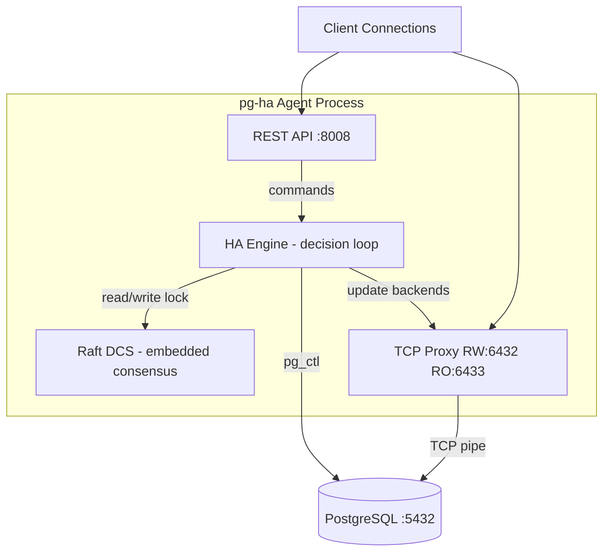
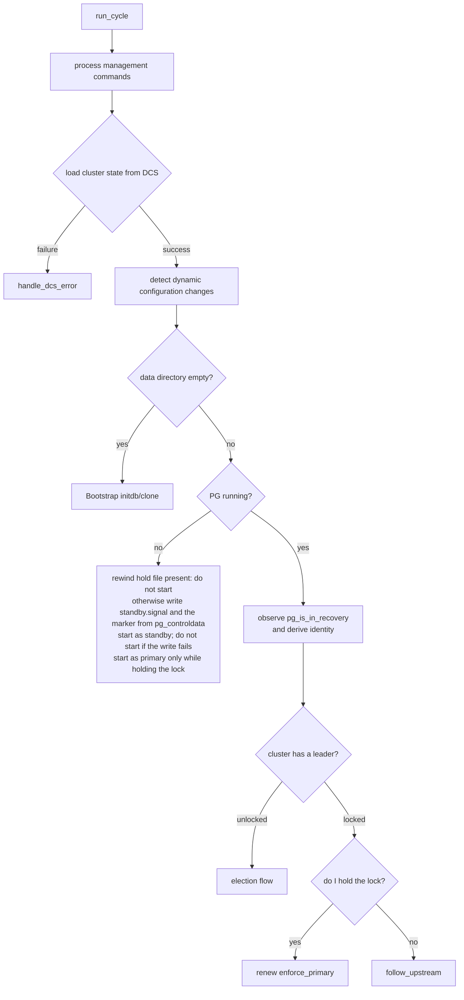
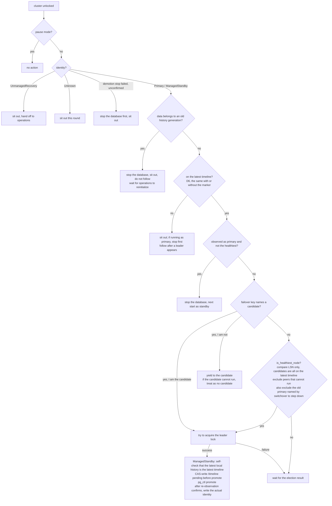
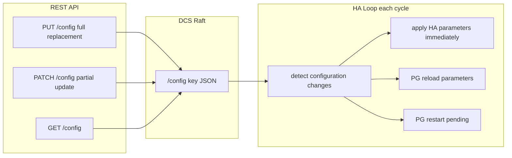
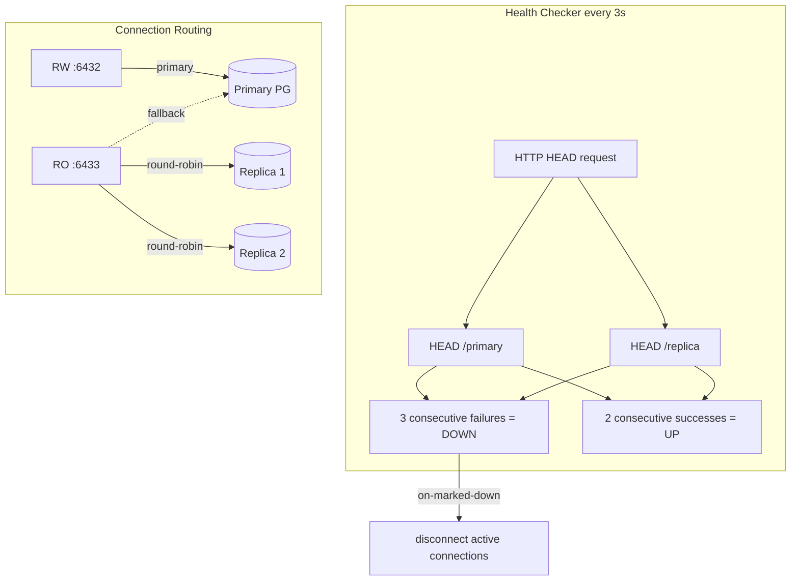
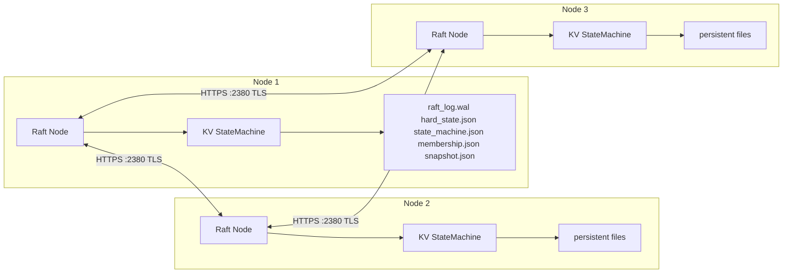
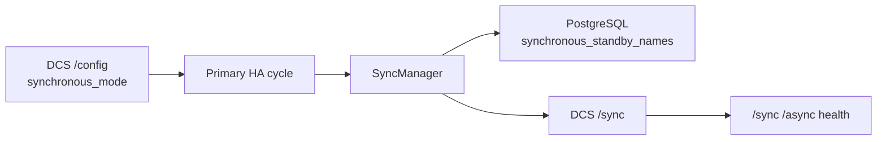
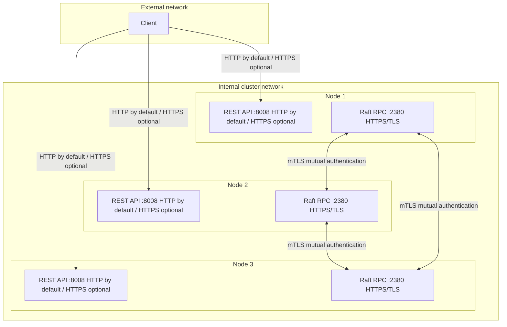

# pg-ha System Architecture

[中文](../pg-ha-architecture.md)

## Overall Architecture



## HA Decision Loop (run_cycle)



Every branch after that decides by identity (Primary / ManagedStandby / UnmanagedRecovery / Unknown), and does not use the role recorded in memory. The full decision table is in [invariants.md](invariants.md) section 1a.

**Time bounds**:
- The main loop starts one round every `loop_wait` seconds; after a round times out the next round starts immediately, and missed ticks are not fired in a burst (`MissedTickBehavior::Delay`).
- Each DCS write waits at most `retry_timeout` seconds, and a timeout is treated as a write failure (in openraft 0.9 a Raft leader does not step down after losing the majority, so without an upper bound lock renewal would hang until the network recovers).
- The lock holder maintains a leader lease: before each lock acquisition / renewal it records an anchor (monotonic clock and wall clock); after success the deadline = anchor + the TTL written into the lock − `watchdog.safety_margin`. Each cycle races this deadline (`Ha::run_cycle_bounded`): if the deadline arrives first, abandon this round, write `standby.signal` and the rewind-check marker first, then `pg_ctl stop -m immediate`. The lease is also checked before `pg_ctl promote` and before remaining primary. There is no fencing under pause.
- The parameter constraint `ttl >= loop_wait + retry_timeout + safety_margin` guarantees a healthy primary can finish one cycle and one lock renewal within the lease. The full rules are in [invariants.md](invariants.md) L5 and 1a "leader lease".

## Election Flow (process_unhealthy_cluster)



Eligibility to run, the format and write timing of `/timeline`, history generations, and operations-forced candidacy are in [invariants.md](invariants.md) section 1a "D6".

## Failover + Rejoin Full Flow

```mermaid
sequenceDiagram
    participant P as Primary (node1)
    participant R1 as Replica (node2)
    participant R2 as Replica (node3)
    participant DCS as Raft DCS

    Note over P: Primary is down
    P->>P: process terminated

    Note over DCS: Leader lock TTL expires (default 30s; Docker dev cluster is 15s)
    R1->>DCS: get_cluster() → unlocked
    R1->>R1: is_healthiest_node() = true
    R1->>DCS: attempt_to_acquire_leader()
    DCS-->>R1: OK (acquired)
    R1->>DCS: write /timeline pending (CAS before promote; do not promote if the write fails)
    R1->>R1: pg_ctl promote
    R1->>R1: re-observe pg_is_in_recovery() = f
    R1->>DCS: /timeline = actual identity {timeline, begin} (CAS, clear pending)
    Note over R1: becomes the new Primary

    R2->>DCS: get_cluster() → leader=node2
    R2->>R2: follow_upstream(node2)
    R2->>R2: detect primary_conninfo change
    R2->>R2: reconfigure → restart PG to point at node2

    Note over P: old Primary restarts
    P->>DCS: get_cluster() → leader=node2
    P->>P: not holding the lock: write standby.signal<br/>pg_controldata = in production → write the rewind-check marker
    P->>P: pg_ctl start (standby mode)
    P->>DCS: node2 holds the lock and is running/primary
    P->>R1: SELECT pg_is_in_recovery() → f (confirm live)
    P->>P: pg_ctl stop
    P->>R1: SELECT pg_is_in_recovery() → f (confirm again after stop)
    P->>P: pg_rewind (from node2)
    alt pg_rewind succeeds
        P->>P: delete the marker, write standby.signal + primary_conninfo
        P->>P: pg_ctl start (standby mode)
        Note over P: automatic streaming catches up
    else pg_rewind fails
        P->>P: stop the database, keep the data directory, write pg-ha.rewind_failed
        Note over P: wait for operations: POST /reinitialize or enable<br/>remove_data_directory_on_rewind_failure
    end
```

## Dynamic Configuration Flow



## TCP Proxy Health Checks



## Raft Consensus Layer



**Persistent files**: `raft_log.wal` (append-only log), `hard_state.json`, `state_machine.json`, `membership.json`, and `snapshot.json`. `snapshot.json` stores the Raft snapshot — snapshots are now written to disk, `new_persistent` reads them back on restart, and therefore `get_current_snapshot` can still return a snapshot after a restart (the snapshot not found that used to appear after a restart and before the next automatic snapshot no longer occurs).

## DCS KV Layout

```
/service/{scope}/
├── leader          → "node1"              (TTL default 30s, Docker dev cluster is 15s, CAS atomic operation)
├── members/
│   ├── node1       → {conn_url, api_url, state, role, wal_position, timeline, rewind_check, lineage}  (TTL)
│   ├── node2       → {conn_url, api_url, state, role, wal_position, timeline, rewind_check, lineage}  (TTL)
│   └── node3       → {conn_url, api_url, state, role, wal_position, timeline, rewind_check, lineage}  (TTL)
├── timeline        → {timeline, begin, primary, generation, pending?}  (no TTL, CAS, written by the lock holder; see invariants D6)
├── initialize      → "system_id"          (atomic create, initialization race)
├── config          → {loop_wait, ttl, synchronous_mode, postgresql: {...}}
├── failover        → {leader, candidate}  (switchover request)
├── sync            → {leader, sync_standby, quorum}
└── history         → [{timestamp, event_type, old_leader, new_leader, reason, timeline?, lsn?}]  (no TTL, CAS, at most 100 entries, appended by the lock-holding primary in the Hold cycle after promote)
```

## Synchronous Replication Data Flow



While holding the Leader Lock, the primary reads the dynamic configuration:

- `synchronous_mode=false` (default): clear `synchronous_standby_names`, write an empty `/sync`
- `synchronous_mode=true`: select synchronous standbys by `sync_priority` / `nosync`, set `FIRST N (...)`, and write `/sync`

When the target value is unchanged, skip the repeated `ALTER SYSTEM` + reload. The `/sync` and `/async` health checks read `/sync.sync_standby` to decide the node role.

Current scope: synchronous replication configuration and status publication are implemented; when `synchronous_mode` is enabled, Failover / Switchover require the candidate to belong to DCS `/sync.sync_standby` (S5). Election / switchover constraints in quorum mode are not yet implemented.

## Module Dependencies

```
pg-ha (binary)
├── pg-ha-core      HA engine + PG lifecycle + configuration + types
│   ├── ha/             decision loop (mod / election / commands / …)
│   ├── postgresql.rs   pg_ctl start/stop/promote/rewind/reload
│   ├── bootstrap.rs    initdb / clone / custom bootstrap
│   ├── dynamic_config.rs  GlobalConfig + change detection + patch
│   ├── slots.rs        replication slot management
│   ├── sync.rs         synchronous replication management
│   ├── cascading.rs    cascading replication
│   ├── standby_cluster.rs  standby cluster
│   ├── watchdog.rs     hardware watchdog
│   ├── callbacks.rs    event callbacks
│   └── history.rs      cluster history
├── pg-ha-dcs       Raft consensus + KV state machine
│   ├── raft_dcs.rs     DcsAdapter implementation
│   ├── store.rs        Raft storage (persistent)
│   ├── state_machine.rs KV + TTL + CAS
│   └── raft_server.rs  HTTP RPC
├── pg-ha-api       REST API (axum)
│   ├── routes/         health checks + management endpoints + /metrics
│   └── state.rs        shared state (AppState)
├── pg-ha-proxy     TCP load balancing
│   └── proxy.rs        RW/RO routing + active health checks
└── pg-ha-ctl       CLI tool (clap + reqwest)
```


## TLS-Encrypted Communication

The Raft RPC layer uses TLS to encrypt all inter-node communication, so cluster consensus data cannot be stolen or tampered with on the network. The REST management API also supports built-in TLS (`restapi.tls`): when it is not configured, the API is plaintext HTTP (as before, exposed only on the internal network); with `cert` + `key` it is HTTPS, and adding `ca_cert` + `require_client_cert: true` makes it mTLS. The two planes share the same server-side mTLS mechanism and certificate material.



**TLS configuration notes:**

| Component | Port | Protocol | Notes |
|------|------|------|------|
| Raft RPC | 2380 | HTTPS (TLS 1.2+) | Inter-node consensus, mTLS supported |
| REST API | 8008 | HTTP (default) / HTTPS | Plaintext HTTP when `restapi.tls` is omitted; `cert`+`key` is HTTPS; adding `ca_cert`+`require_client_cert` is mTLS |
| PostgreSQL | 5432 | TCP | PG native protocol; `ssl` can be configured independently |
| Proxy RW/RO | 6432/6433 | TCP | Passthrough of PG connections |

- Once Raft RPC TLS is enabled, all `AppendEntries`, `RequestVote`, and `InstallSnapshot` RPCs travel over the encrypted channel
- mTLS (mutual TLS) can optionally be enabled: each node also verifies the peer certificate, preventing unauthorized nodes from joining the cluster
- The REST API is plaintext HTTP by default, exposed only on the internal network, with management endpoints protected by Basic Auth; when encryption is required, configure `restapi.tls` to enable HTTPS/mTLS. **Basic Auth credentials are protected in transit only after REST TLS is enabled**

## Authentication and Security

```mermaid
flowchart LR
    subgraph Endpoints["REST API endpoints"]
        direction TB
        OPEN[Open endpoints, no authentication]
        PROTECTED[Protected endpoints, authentication required]
    end

    subgraph OpenEndpoints["Health checks - used by load balancers"]
        GET_PRIMARY["GET /primary"]
        GET_REPLICA["GET /replica"]
        GET_SYNC["GET /sync"]
        GET_ASYNC["GET /async"]
        GET_HEALTH["GET /health"]
        GET_LIVENESS["GET /liveness"]
        GET_CLUSTER["GET /cluster"]
        GET_METRICS["GET /metrics"]
        GET_PATRONI["GET /patroni"]
        GET_HISTORY["GET /history"]
        GET_STANDBY["GET /standby-leader"]
        GET_ROOT["GET / and /read-write"]
        GET_SYNC_ALIAS["GET /synchronous"]
        GET_ASYNC_ALIAS["GET /asynchronous"]
    end

    subgraph ProtectedEndpoints["Management operations - Basic Auth"]
        POST_SWITCHOVER["POST /switchover"]
        POST_FAILOVER["POST /failover"]
        POST_RESTART["POST /restart"]
        POST_REINIT["POST /reinitialize"]
        CONFIG["GET/PUT/PATCH /config"]
    end

    OPEN --> OpenEndpoints
    PROTECTED --> ProtectedEndpoints
```



**Authentication mechanism:**

- **Basic Auth**: enabled automatically once `restapi.username` and `restapi.password` are configured
- When authentication is not configured, all endpoints are open (for a fully isolated internal network)
- Health-check endpoints are always open, for load balancers and TCP Proxy health probes
- Management endpoints (switchover, failover, config changes, and so on) are protected by Basic Auth

```yaml
# Configuration example
restapi:
  listen: 0.0.0.0
  port: 8008
  username: admin      # Basic Auth is enabled once this is set
  password: s3cr3t     # Management endpoints require this credential
```

**Request examples:**

```bash
# Health check (no authentication)
curl http://localhost:8008/health
curl http://localhost:8008/primary
curl http://localhost:8008/replica

# Management operation (Basic Auth required)
curl -u admin:s3cr3t -X POST http://localhost:8008/switchover \
  -H 'Content-Type: application/json' \
  -d '{"leader": "node1", "candidate": "node2"}'

# Unauthenticated requests return 401
curl -X POST http://localhost:8008/failover
# → {"error": "Unauthorized"}
```

> The examples above are plaintext HTTP (`restapi.tls` is not configured). After `restapi.tls` is enabled, use `https://` and `--cacert` to trust the CA of the server certificate (mTLS also adds `--cert` / `--key`). Every node's REST TLS mode must be the same; mixed clusters are not supported.

## Graceful Shutdown

After the first `SIGTERM` or `SIGINT`, pg-ha calls `Ha::graceful_shutdown` (`crates/pg-ha-core/src/ha/shutdown.rs`; `src/main.rs` only calls it). Rules: renew the lock during drain; CHECKPOINT and stopping the database are bounded by the leader lease; release the lock only after the database has stopped; never exit while holding the lock if PostgreSQL might still be writable.

```mermaid
sequenceDiagram
    participant OS as Operating system
    participant PGHA as pg-ha Agent
    participant PG as PostgreSQL
    participant DCS as Raft DCS
    participant OTHER as Other nodes

    OS->>PGHA: SIGTERM / SIGINT
    PGHA->>PGHA: HA loop stops; REST API and Proxy keep serving
    Note over PGHA: /primary is always 503, PG is not started, management commands are rejected
    alt holding the lock but the lease has expired
        PGHA->>PG: standby.signal + marker, pg_ctl stop -m immediate
        Note over PGHA: no drain, no CHECKPOINT, do not release the lock
    else lease still valid
        loop drain (drain_timeout_secs), every loop_wait
            PGHA->>DCS: update_leader (renew the lock)
            Note over PGHA: renewal fails: immediate fence, do not release the lock (WARN only under pause)
        end
        par race the lease from the last renewal
            PGHA->>PG: CHECKPOINT (while holding the lock)
            PGHA->>PG: standby.signal + marker, pg_ctl stop -m fast
            PGHA->>PG: on failure, try pg_ctl stop -m immediate once more
        end
        alt PG has stopped
            PGHA->>DCS: delete_leader (CAS, wait at most retry_timeout)
            PGHA->>OS: exit(0)
        else lease expires first
            PGHA->>PG: standby.signal + marker, pg_ctl stop -m immediate
            Note over PGHA: do not release the lock; the lock expires by TTL
            PGHA->>OS: exit(0)
        else PG may be writable and will not stop
            loop every loop_wait: normal HA loop
                PGHA->>DCS: renew the lock (while holding it)
                PGHA->>PG: retry pg_ctl stop (holding the lock: -m fast; not holding it: -m immediate)
                Note over PGHA: ERROR: give the manual stop command; a further signal only makes the next round run immediately
            end
            Note over PG: operations stops the database by hand
            PGHA->>DCS: delete_leader
            PGHA->>OS: exit(0)
        end
    end

    Note over OTHER: after the lock is released or expires
    OTHER->>DCS: attempt_to_acquire_leader()
    OTHER->>OTHER: pg_ctl promote
```

**Key design decisions:**

1. **Release the lock only after the database has stopped**: the lock stays with this node until PostgreSQL is confirmed stopped. Deleting the lock first would let another node promote while this node can still write.
2. **Renew the lock during drain**: `drain_timeout_secs` (default 30 seconds) is longer than the default lease (25 seconds); without renewal the lock would expire during drain. A failed renewal fences as loss of the lock (except under pause, W1).
3. **Teardown is bounded by the lease**: the last renewal is at the end of drain, and its lease (`ttl − safety_margin`) bounds CHECKPOINT and the stop, racing the same way as `run_cycle_bounded`. If the deadline arrives first, fence as a lease expiry and do not release the lock, so this node is already not writable before the lock expires and another node promotes (L5 time bound).
4. **fast, then immediate on failure**: `-m fast` disconnects clients and performs a shutdown checkpoint; if it fails and PG is still running, try `-m immediate` once more. Both attempts are inside the lease race.
5. **Do not exit if it will not stop**: after exit the lock would expire, and nothing would fence this PostgreSQL that might still be writable. pg-ha keeps running the normal HA loop (renew the lock, and retry the stop each round according to `stop_pending`), logs ERROR each round and gives the manual stop command, and releases the lock and exits only after the stop is confirmed. A further SIGTERM / SIGINT still does not cause an exit. PostgreSQL observed in recovery also counts as possibly writable, unless it does not hold the lock and has `standby.signal`: a recovery that holds the lock (pg-ha would promote it) and a recovery without `standby.signal` (`recovery.signal`, which promotes itself when it ends), if they cannot be stopped, likewise do not exit; the HA loop only retries the stop and does not promote. During shutdown, while not holding the lock, each round only stops again with `-m immediate`, and does not enter the election or follow. Only a standby that does not hold the lock and has `standby.signal`, when it cannot be stopped, logs ERROR and then exits. The REST API is served by a separate task and stays available throughout this time, and `/primary` stays 503.
6. **SIGKILL is out of scope**: after systemd `TimeoutStopSec` or `docker stop -t` expires, pg-ha is killed and the rules above cannot run, so the timeout must be greater than the time for drain + CHECKPOINT + stop (see the operations guide). Switch over before stopping the primary.

**Timeline (default configuration; the Docker dev cluster uses `ttl` 15 and `loop_wait` 5):**

| Phase | Duration | Notes |
|------|------|------|
| Signal | < 1ms | HA loop stops, `/primary` becomes 503 |
| drain | `drain_timeout_secs` (30s) | Wait only; renew the lock every `loop_wait` |
| CHECKPOINT + stop | Usually a few seconds, capped at `ttl − safety_margin` (25s, Docker 10s) | Fence if the cap is exceeded |
| Release the lock | ≤ `retry_timeout` | Only after the database has stopped |
| Failover | ≤ `loop_wait` + promote | Other nodes elect and promote after seeing unlocked |
| **Total write unavailability** | **about 30-45s** | From the signal until the new primary is ready; a switchover first can avoid it |

## Logging

pg-ha uses `tracing` + `tracing-subscriber` to provide dual-mode text/json log output.

**Switching log mode:**

| Environment variable | Value | Effect |
|---------|---|------|
| `PG_HA_LOG_FORMAT` | `text` (default) | Human-readable colored logs |
| `PG_HA_LOG_FORMAT` | `json` | Structured JSON logs (recommended for production) |
| `RUST_LOG` | tracing filter expression | Controls log level and module filters |

**Text mode example (default):**

```
2024-01-15T10:30:00.123Z  INFO pg_ha: Starting pg-ha agent name="node1" scope="prod-cluster"
2024-01-15T10:30:02.456Z  INFO pg_ha_dcs: Raft cluster bootstrapped with 3 members
2024-01-15T10:30:05.789Z  INFO pg_ha_core::ha: run_cycle completed role=Primary leader=true
```

**JSON mode example (`PG_HA_LOG_FORMAT=json`):**

```json
{"timestamp":"2024-01-15T10:30:00.123Z","level":"INFO","target":"pg_ha","message":"Starting pg-ha agent","name":"node1","scope":"prod-cluster"}
{"timestamp":"2024-01-15T10:30:02.456Z","level":"INFO","target":"pg_ha_dcs","message":"Raft cluster bootstrapped with 3 members"}
{"timestamp":"2024-01-15T10:30:05.789Z","level":"INFO","target":"pg_ha_core::ha","message":"run_cycle completed","role":"Primary","leader":true}
```

**RUST_LOG environment variable:**

```bash
# Default level (built-in)
RUST_LOG="pg_ha=info,openraft::replication=off"

# Debug the HA decision loop
RUST_LOG="pg_ha_core::ha=debug,pg_ha=info"

# Debug Raft consensus
RUST_LOG="pg_ha_dcs=debug,openraft=debug,pg_ha=info"

# Debug network communication
RUST_LOG="pg_ha_dcs::network=trace,pg_ha=info"

# Full trace (verbose output, debugging only)
RUST_LOG="trace"
```

**Log format precedence:**

1. The `PG_HA_LOG_FORMAT` environment variable overrides the default
2. The `RUST_LOG` environment variable overrides the built-in filter expression
3. Built-in default: `pg_ha=info` + `openraft::replication=off` (suppresses high-frequency replication logs)
