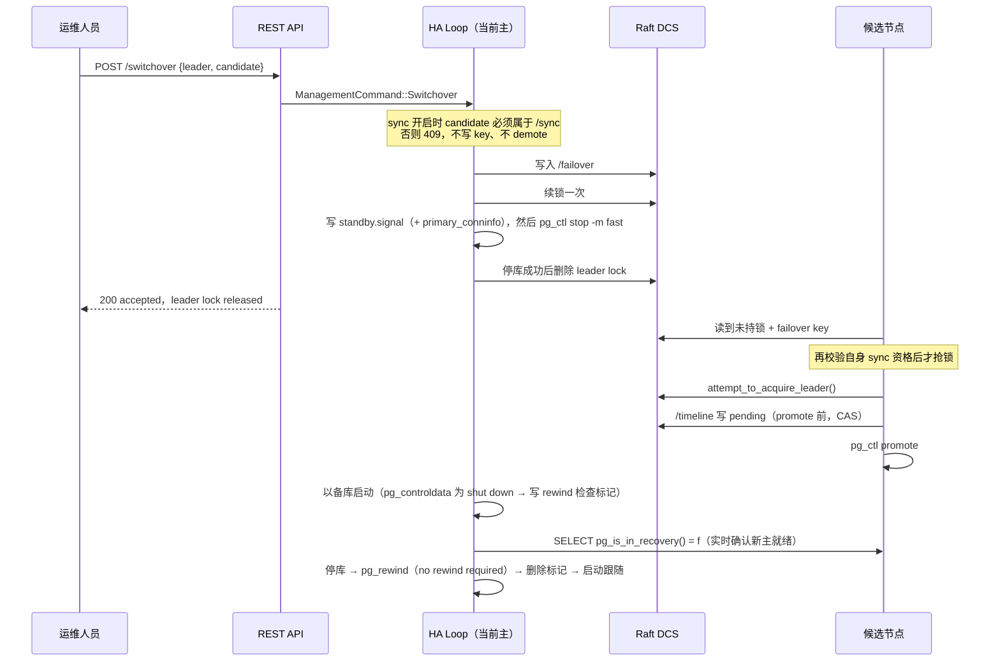
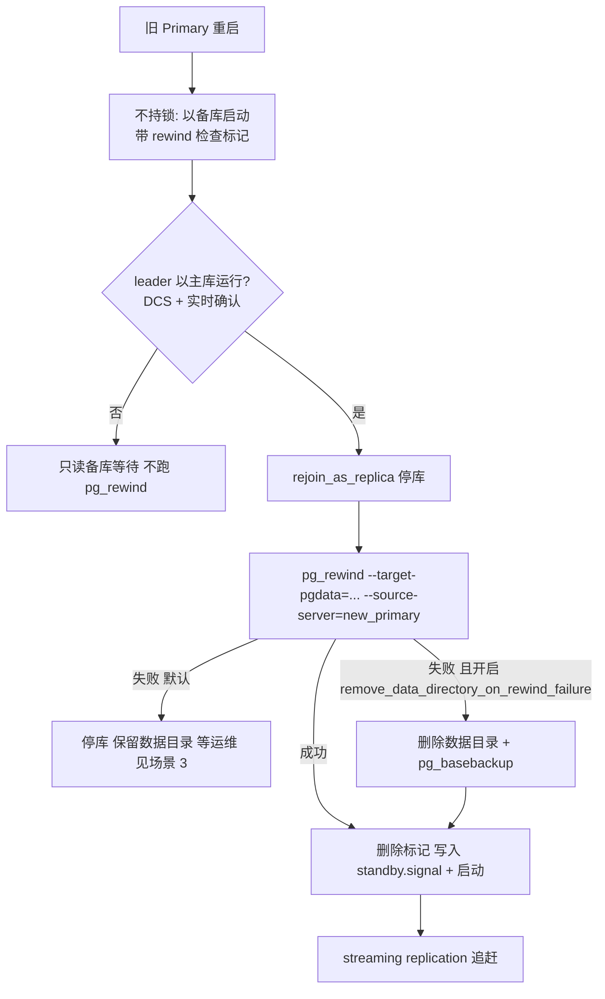

# pg-ha 运维指南

## 集群状态检查

### 集群总览

```bash
# 集群拓扑：每个成员的角色和复制上游（不是完整成员对象）
curl -s http://localhost:8008/cluster | jq .
```

响应来自 `CascadeManager::build_cascade_topology`。角色是小写（`primary` / `replica` / `standby_leader`）。Primary 没有 `upstream`。带 `tags.replicatefrom` 的副本会多一个 `replicatefrom` 字段；上游不健康时 `upstream` 回退到当前 leader。

```json
{
  "scope": "prod-cluster",
  "members": [
    {"name": "node1", "role": "primary", "upstream": null},
    {"name": "node2", "role": "replica", "upstream": "node1"},
    {"name": "node3", "role": "replica", "upstream": "node1"}
  ]
}
```

节点自己的运行状态、timeline、WAL、lag、暂停和待重启标志在 **本节点** 的 `/patroni` 上，不在 `/cluster` 里：

```bash
curl -s http://localhost:8008/patroni | jq .
```

```json
{
  "state": "Running",
  "role": "Primary",
  "scope": "prod-cluster",
  "name": "node1",
  "timeline": 1,
  "wal_position": 12345678,
  "replication_lag": 0,
  "paused": false,
  "pending_restart": false,
  "tags": {}
}
```

`/patroni` 的 `role` / `state` 是 Rust Debug 写法（`Primary`、`Replica`、`Running`），和 `/cluster` 的小写角色不是同一套字符串。

健康检查（`/primary`、`/replica`、`/health`、`/liveness`、`/sync`、`/async`、`/cluster`、`/patroni`、`/metrics`、`/history`）不要求认证。`/switchover`、`/failover`、`/restart`、`/reinitialize`、`/config` 在 YAML 里设置了 `restapi.username` 时要求 HTTP Basic Auth。Docker 入口默认用户名 `admin`、密码 `secret`。

### Primary 检查

```bash
# 返回 200 表示该节点是 Primary 且持有 Leader Lock
curl -s -o /dev/null -w "%{http_code}" http://localhost:8008/primary
# 200 → Primary, 503 → 不是 Primary

# 带详情
curl -s http://localhost:8008/primary | jq .
```

### Replica 检查

```bash
# 返回 200 表示该节点是健康的 Replica
curl -s -o /dev/null -w "%{http_code}" http://localhost:8008/replica
# 200 → 健康 Replica, 503 → 不是 Replica 或不健康

# 带 lag 阈值检查（单位：字节）
curl -s http://localhost:8008/replica?lag=1048576 | jq .
# lag 超过 1MB 时返回 503
```

### 同步 / 异步备库检查

启用同步复制后，可用以下端点区分同步备库与异步备库（依据 DCS `/sync` 名单）：

```bash
# 同步备库：健康 Replica 且在 /sync.sync_standby 名单中 → 200
curl -s -o /dev/null -w "%{http_code}" http://localhost:8008/sync
# 别名: /synchronous

# 异步备库：健康 Replica 且不在同步名单中 → 200
curl -s -o /dev/null -w "%{http_code}" http://localhost:8008/async
# 别名: /asynchronous
```

未启用同步复制、或 `/sync` 为空时：所有健康 Replica 对 `/async` 返回 200，对 `/sync` 返回 503。Primary 对两者都返回 503。

### 健康检查

```bash
# PostgreSQL 是否运行中
curl -s http://localhost:8008/health | jq .

# Liveness（HA Loop 是否在 TTL 内执行过）
curl -s -o /dev/null -w "%{http_code}" http://localhost:8008/liveness

# 节点完整状态
curl -s http://localhost:8008/patroni | jq .
```

### Prometheus 指标

```bash
curl -s http://localhost:8008/metrics
```

输出：

```
# HELP pg_ha_node_role Current role of this node
# TYPE pg_ha_node_role gauge
pg_ha_node_role{role="primary"} 1
# HELP pg_ha_pg_state Current PostgreSQL state (1 = active for the labeled state)
# TYPE pg_ha_pg_state gauge
pg_ha_pg_state{state="running"} 1
# HELP pg_ha_replication_lag_bytes Replication lag in bytes
# TYPE pg_ha_replication_lag_bytes gauge
pg_ha_replication_lag_bytes 0
# HELP pg_ha_timeline Current PostgreSQL timeline
# TYPE pg_ha_timeline gauge
pg_ha_timeline 1
# HELP pg_ha_dcs_last_seen_seconds Seconds since last successful DCS communication
# TYPE pg_ha_dcs_last_seen_seconds gauge
pg_ha_dcs_last_seen_seconds 2.345
# HELP pg_ha_failsafe_active Whether failsafe mode is currently active (1 = active)
# TYPE pg_ha_failsafe_active gauge
pg_ha_failsafe_active 0
# HELP pg_ha_pending_restart Whether a PostgreSQL restart is pending (1 = pending)
# TYPE pg_ha_pending_restart gauge
pg_ha_pending_restart 0
# HELP pg_ha_is_paused Whether the cluster is in pause mode (1 = paused)
# TYPE pg_ha_is_paused gauge
pg_ha_is_paused 0
```

`pg_ha_failsafe_active` 会输出，但进程启动后没有代码更新它，数值保持 `0`。`failsafe_mode` 写入 DCS 也不会打开 Failsafe。不要按这个指标告警。见 [TODO #4](TODO.md)。

---

## 手动 Switchover

Switchover 是计划内的主从切换，不丢数据。要求当前 Primary 健康且可达。

> ⚠️ **同步复制**：若已启用 `synchronous_mode`，指定的 `candidate` 必须在当前 DCS `/sync.sync_standby` 名单中，否则返回 **409**（不 demote、不写 failover key）。可先用各节点的 `GET /sync`（200 = 在名单中的健康 Replica）确认候选。详见下文「同步复制」。

```bash
# 指定 leader 和 candidate
curl -u admin:secret -X POST http://localhost:8008/switchover \
  -H 'Content-Type: application/json' \
  -d '{"leader": "node1", "candidate": "node2"}'

# 不指定 candidate（在除本节点以外的运行成员里选最健康的；本节点不参选。
# sync 开启时继任者仍须落在 /sync 名单内。没有合格继任者时 409，不降级）
curl -u admin:secret -X POST http://localhost:8008/switchover \
  -H 'Content-Type: application/json' \
  -d '{"leader": "node1"}'

# 计划执行：带 scheduled_at（ISO 8601）时只记在本进程内存里
curl -u admin:secret -X POST http://localhost:8008/switchover \
  -H 'Content-Type: application/json' \
  -d '{"leader": "node1", "candidate": "node2", "scheduled_at": "2026-10-17T01:00:00Z"}'
```

立即 switchover 的响应：

```json
{"status": "accepted", "message": "Switchover initiated, leader lock released"}
```

带 `scheduled_at` 时 HTTP 200，`message` 为 `Switchover scheduled`（请求留在本进程内存，重启即丢失）。`status` 一律小写：`accepted`、`rejected`、`error`。不合格候选（sync 开启且不在 `/sync`）返回 HTTP 409：

```json
{"status": "rejected", "message": "Candidate 'node3' is not a synchronous standby (sync mode requires /sync membership)"}
```

候选不存在、带 `nofailover` 或不在 Running，同样是 409。候选带 rewind 检查标记（`pg-ha.rewind_check`，尚未经 pg_rewind 验证）时也是 409，`POST /failover` 同样：

```json
{"status": "rejected", "message": "Candidate 'node2' has a rewind-check marker (not yet verified with pg_rewind)"}
```

请求受理之后 candidate 按 [invariants.md](invariants.md) 1a「D6」不能参选时（例如它不在最新 timeline 上），其他节点打 WARN `Designated candidate <c> may not take part in the election (it is not shown to be on the latest timeline); proceeding as if no candidate were designated`，按没有指定 candidate 选举：仍排除 `/failover` 里的 `leader`，不把锁还给刚退下来的旧主。

不指定 candidate、且除本节点外没有处于 running、允许 failover、并且（sync 开启时）属于 `/sync` 的成员时，返回 409，不写 `/failover`、不停库：

```json
{"status": "rejected", "message": "No other running member can take over; refusing switchover without a candidate"}
```

**取消已计划的 switchover：**

```bash
curl -u admin:secret -X DELETE http://localhost:8008/switchover
```

**立即 Switchover 在发起节点上的动作**（没有先跑 CHECKPOINT；CHECKPOINT 只在进程收到 SIGTERM/SIGINT 的停机路径里）：

1. 校验候选（含同步复制资格）
2. 把 `{leader, candidate}` 写入 DCS `/failover`
3. 续一次 leader lock（命令执行期间 HA 循环不跑）；续锁失败则按租约到期围栏，返回 error `Switchover aborted: leader lock renewal failed; ...`
4. 写入 `standby.signal` 并 fsync；有 candidate 时把 `postgresql.auto.conf` 的 `primary_conninfo` 指到候选，没有时删除 `primary_conninfo`；`postgresql.auto.conf` 的其他设置保留
5. `pg_ctl stop -m fast`，角色改为 Replica
6. 确认停库后才删除本节点 leader lock。停库失败时锁留下，返回 error `Switchover initiated, but stopping PostgreSQL failed: ...; pg-ha keeps fencing it and holds the leader lock`，之后每轮续锁并重试停库（见下文「switchover 卡住」）。删除锁失败时也留下锁，并且不启动 PostgreSQL（`Not starting PostgreSQL: the leader lock may still be ours ...`），下一轮重试删除；确认锁已不是自己的之后才以备库启动



**switchover 之后旧主的 rewind 检查**：旧主 `pg_ctl stop -m fast` 之后 `pg_controldata` 为 `shut down`，下次启动时按启动规则写 rewind 检查标记，日志：

```text
Created rewind-check marker: pg_controldata reports 'shut down' (last ran as a primary)
Starting PostgreSQL as a standby (not holding the leader lock)
```

看到新主就绪后：

```text
Rewind-check marker present and <new> holds the leader lock — checking with pg_rewind before following
Running pg_rewind to resync from current primary
pg_rewind succeeded; removed the rewind-check marker
```

正常 switchover 没有分叉，pg_rewind 报 `no rewind required`。所以每次 switchover 后旧主都会多一次「以备库启动 → 停库 → pg_rewind → 再启动」，期间短暂不可用于只读流量。在这次检查完成之前，以旧主为 candidate 的反向 switchover / failover 会被拒绝（409，`Candidate '<old>' has a rewind-check marker (not yet verified with pg_rewind)`），等日志出现 `pg_rewind succeeded` 后再发。

---

## 手动 Failover

Failover 用于 Primary 不可达时的紧急切换。无需当前 Primary 参与。

> ⚠️ **同步复制**：启用 `synchronous_mode` 时，指定的 `candidate` 同样必须属于 `/sync` 名单，否则 **409**。不指定 candidate 时写入选举请求后，仍只有名单内节点会抢锁；名单为空则可能长时间无主（保已确认事务）。详见「同步复制」。

```bash
# 指定 candidate
curl -u admin:secret -X POST http://localhost:8008/failover \
  -H 'Content-Type: application/json' \
  -d '{"candidate": "node2"}'

# 不指定 candidate（选最健康节点；sync 开启时仍受 /sync 约束）
curl -u admin:secret -X POST http://localhost:8008/failover \
  -H 'Content-Type: application/json' \
  -d '{}'
```

响应（HTTP 200）：

```json
{"status": "accepted", "message": "Failover request submitted"}
```

> ⚠️ **注意**：
> - **未开 sync**：Failover 可能丢失尚未复制到副本的 WAL。Primary 仍可达时请优先 Switchover。
> - **已开 sync**：切到 `/sync` 名单内节点时，已向客户端确认的提交应仍在新主上；若名单为空或候选不合格，系统宁可不切换，也不会为了可用性抬升异步副本。

---

## 动态配置变更

动态配置存储在 DCS `/config` key 中，所有节点每个 HA 周期自动检测并应用变更。

### 读取当前配置

```bash
curl -u admin:secret http://localhost:8008/config | jq .
```

### 部分更新 (PATCH)

```bash
# 修改 loop_wait 和 ttl（结果须满足下文「HA 时间参数约束」，否则返回 400 且不写入）
curl -u admin:secret -X PATCH http://localhost:8008/config \
  -H 'Content-Type: application/json' \
  -d '{
    "loop_wait": 15,
    "ttl": 45
  }'

# 修改 PG 参数（需要 reload 的）
curl -u admin:secret -X PATCH http://localhost:8008/config \
  -H 'Content-Type: application/json' \
  -d '{
    "postgresql": {
      "parameters": {
        "work_mem": "128MB",
        "effective_cache_size": "8GB"
      }
    }
  }'

# 删除某个配置项（设为 null）
curl -u admin:secret -X PATCH http://localhost:8008/config \
  -H 'Content-Type: application/json' \
  -d '{
    "maximum_lag_on_failover": null
  }'

# 启用暂停模式（停止自动 failover）
curl -u admin:secret -X PATCH http://localhost:8008/config \
  -H 'Content-Type: application/json' \
  -d '{"pause": true}'

# 关闭暂停模式
curl -u admin:secret -X PATCH http://localhost:8008/config \
  -H 'Content-Type: application/json' \
  -d '{"pause": false}'

# 启用同步复制（默认关闭）
curl -u admin:secret -X PATCH http://localhost:8008/config \
  -H 'Content-Type: application/json' \
  -d '{
    "synchronous_mode": true,
    "synchronous_mode_strict": false,
    "synchronous_node_count": 1
  }'

# 关闭同步复制
curl -u admin:secret -X PATCH http://localhost:8008/config \
  -H 'Content-Type: application/json' \
  -d '{"synchronous_mode": false}'
```

### 全量替换 (PUT)

```bash
curl -u admin:secret -X PUT http://localhost:8008/config \
  -H 'Content-Type: application/json' \
  -d '{
    "loop_wait": 10,
    "ttl": 30,
    "retry_timeout": 10,
    "maximum_lag_on_failover": 1048576,
    "postgresql": {
      "parameters": {
        "work_mem": "64MB",
        "max_connections": "200"
      }
    }
  }'
```

### 配置变更生效规则

| 参数类型 | 生效方式 | 示例 |
|---------|---------|------|
| HA 参数 | 下一 cycle 立即应用 | `loop_wait`, `ttl`, `pause` |
| 同步复制参数 | Primary 下一 cycle：改 PG + 写 DCS `/sync` | `synchronous_mode`, `synchronous_mode_strict`, `synchronous_node_count` |
| PG reload 参数 | 自动执行 `pg_ctl reload` | `work_mem`, `effective_cache_size` |
| PG restart 参数 | 设置 `pending_restart` 标志，不自动重启 | `max_connections`, `shared_buffers`, `wal_level`, `max_wal_senders` |
| `failsafe_mode` | 会写入 DCS `/config`，HA 循环不读取 | 见 [TODO #4](TODO.md) |
| `standby_cluster` | 下一 cycle：持锁节点改为跟随远端 | 见下文「Standby cluster」 |

对于需要 restart 的参数，需手动执行：

```bash
curl -u admin:secret -X POST http://localhost:8008/restart
```

在持锁的节点上，PG 按原角色重启。在不持锁的节点上，pg-ha 先按启动规则做准备（写 `standby.signal`，`pg_controldata` 显示上次以主库运行时写 rewind 检查标记），再停库、以备库启动；准备失败时返回错误 `Not restarting PostgreSQL: standby configuration could not be written: ...`，PG 不动（见 [invariants.md](invariants.md) 1a「启动规则」）。

### HA 时间参数约束

`ttl`、`loop_wait`、`retry_timeout` 和 `watchdog.safety_margin` 必须满足：

```text
ttl >= loop_wait + retry_timeout + watchdog.safety_margin，且 retry_timeout >= 1
```

原因：锁持有者在最后一次续锁**开始前**的时刻 + `ttl` − `safety_margin` 秒内没有再次续锁成功，就自己停掉 PostgreSQL（leader 租约，见 [invariants.md](invariants.md) 1a「leader 租约」）；健康的主库要在这段时间里完成一轮 HA 周期（`loop_wait`）和一次续锁写（每次 DCS 写最多等 `retry_timeout` 秒）。默认值 30 ≥ 10 + 10 + 5，docker 开发集群 15 ≥ 5 + 5 + 5。

- 静态配置（`pg-ha.yml`、环境变量覆盖、`bootstrap.dcs`）不满足时 pg-ha 拒绝启动，`--validate-config` 同样报错：
  ```text
  Error: Configuration error: ttl (20) must be >= loop_wait (10) + retry_timeout (6) + watchdog.safety_margin (5) = 21: ...
  ```
  `bootstrap.dcs` 不满足时错误以 `bootstrap.dcs:` 开头。
- `PATCH` / `PUT /config` 改动 `ttl`、`loop_wait` 或 `retry_timeout` 后不满足时返回 400，配置不写入：
  ```json
  {"error": "Rejected, configuration not changed: ttl (15) must be >= loop_wait (6) + retry_timeout (5) + watchdog.safety_margin (5) = 16: ..."}
  ```
  动态配置里没有的项按接收请求的节点的静态值计算；`safety_margin` 只有静态值。不改这三项的请求不检查。
- 已知缺口：动态修改 `ttl` 目前不改变写进锁的 TTL，DCS 写的超时也一直是静态 `retry_timeout`（[invariants.md](invariants.md) 第 9 节）。调大 `loop_wait` 前，先确认静态 `ttl` 也满足约束。

**分区下的旧主**：锁持有者与多数派断开后，最晚在最后一次续锁开始后 `ttl − safety_margin` 秒停掉 PostgreSQL（默认 25 秒，docker 10 秒），不论 DCS 调用是否返回；多数派最早在 `ttl` 秒后抢锁。前提是节点间墙钟偏差小于 `safety_margin`。pause 下不围栏。相关日志：

| 日志 | 含义 |
|------|------|
| WARN `DCS write timed out after <n>s (retry_timeout); treating it as failed` | 一次 DCS 写在 `retry_timeout` 内没有完成（例如本节点是失去多数派的 Raft leader），按写失败处理。这次写之后仍可能提交，这是安全的（[invariants.md](invariants.md) 1a） |
| ERROR `Leader lease expired before the lock renewal completed; fencing PostgreSQL (immediate stop) without waiting for the DCS` | 租约到期，本轮 HA 周期被放弃，PostgreSQL 以 `immediate` 模式停库 |
| ERROR `Leader lease expired before pg_ctl promote; fencing PostgreSQL (immediate stop)` / `Leader lease expired before reporting the leader role; fencing PostgreSQL (immediate stop)` | 续锁返回成功，但返回时租约已经到期（续锁写太慢），不 promote、不报告主库，按失去锁围栏 |
| ERROR `Leader lease already expired at shutdown; skipping drain, CHECKPOINT and lock release, fencing PostgreSQL (immediate stop)` | 关停时租约已到期，直接围栏停库 |
| ERROR `Leader lease expired before CHECKPOINT and the PostgreSQL stop finished during shutdown; fencing PostgreSQL (immediate stop) and keeping the leader lock` | 关停收尾（CHECKPOINT + 停库）没在最后一次续锁的租约内完成，围栏停库，不释放锁 |
| INFO `Created rewind-check marker: leader lease expired before renewal` | 围栏停库前写了 `standby.signal` 和 rewind 检查标记；之后按启动规则以备库启动，看到新 leader 后先 pg_rewind |

健康集群里如果出现租约围栏，通常是 PG 或 DCS 太慢，一轮续锁来不及在 `ttl − safety_margin` 内完成，可以调大 `ttl`。

---

## 同步复制

### 原理

PostgreSQL 的异步复制中，Primary COMMIT 后立即返回客户端成功，不等任何 Replica 确认。如果 Primary 此时崩溃，最近几秒的已确认事务可能丢失。

同步复制改变了这个行为：Primary 在 COMMIT 时，**必须等待至少 N 个同步备库确认收到 WAL** 后才返回客户端"成功"。这保证了——客户端收到"OK"的事务，数据至少存在于 2 个节点上。

pg-ha 通过 PostgreSQL 的 `synchronous_standby_names` 参数控制哪些节点是同步备库。这个参数的值有两种形式：

```
FIRST 1 (node2,node3)    -- Priority 模式：列表中第一个可用节点确认即可
ANY 2 (node1,node2,node3) -- Quorum 模式：任意 2 个节点确认即可
```

### 工作流程

pg-ha 在每个 HA cycle 中（仅 Primary 执行）：

1. 从 DCS 读取动态配置（`synchronous_mode` 等参数）
2. 获取所有集群成员的状态（Running/Crashed、角色、WAL position）
3. 按筛选条件和优先级计算出 `synchronous_standby_names` 目标值
4. 如果与上次不同 → `ALTER SYSTEM SET synchronous_standby_names = '...'` + `pg_ctl reload`。每个主任期第一次总会执行（降级或重写备库配置时 pg-ha 会忘掉上次应用的值）
5. 将当前 sync 状态写入 DCS `/sync` key（供健康检查 API 使用）

**筛选条件**（同时满足才能成为 sync standby 候选）：
- 不是 Primary 自己
- 节点状态为 Running
- 节点角色为 Replica
- 没有 `nosync: true` 标签

**排序规则**：
- `sync_priority` 标签值越大越靠前
- 优先级相同时按节点名字字母序

### 场景分析

#### 正常运行（3 节点，sync_node_count=1）

```
Primary: node1
synchronous_standby_names = 'FIRST 1 (node2,node3)'
pg_stat_replication:
  node2 → sync    (第一优先，确认后 Primary 才返回 COMMIT)
  node3 → async   (备选)
```

#### Sync standby 断开（node2 网络断开）

pg-ha 检测到 node2 非 Running → 重新计算 → `'FIRST 1 (node3)'`
PG 自动将 node3 提升为 sync。写入不中断。

#### 所有 Replica 都挂了

- `strict_mode = false`：设为空字符串 `''`，PG 退化为异步，写入不阻塞
- `strict_mode = true`：设为 `'*'`，PG 阻塞所有 COMMIT，直到有 Replica 恢复

#### 节点重新加入

node2 恢复 → pg-ha 标记为 Running → 下一个 HA cycle 重新计算 →
`'FIRST 1 (node2,node3)'`（node2 被自动加回列表）

#### 手动 Switchover（Primary 从 node1 切到 node2）

1. node1 demote 为 Replica → 不再调用 `enforce_synchronous_replication`
2. node2 promote 为 Primary → 首个 cycle 计算新的 sync 列表
3. 结果：`'FIRST 1 (node1,node3)'`（node1 现在是 Replica 候选）

**无残留**：降级不再覆盖 `postgresql.auto.conf`（只替换 `primary_conninfo` / `recovery_target_timeline`），`synchronous_standby_names` 留在副本上，被 PG 忽略（仅 Primary 读取此参数）；它下次成为主库时，pg-ha 在第一个 cycle 重新写入当前的期望值。

#### Failover（Primary 崩溃）

1. Leader lock 超时，新选举产生 node2 为 Primary
2. node2 promote 后首个 cycle 计算 sync 列表
3. node1（已崩溃）被过滤掉 → `'FIRST 1 (node3)'`

### 配置参数

#### 动态配置（存储在 DCS `/config`，运行时通过 API 修改）

| 参数 | 类型 | 默认值 | 说明 |
|------|------|--------|------|
| `synchronous_mode` | bool | `false` | 是否启用同步复制。关闭时 `synchronous_standby_names` 被清空 |
| `synchronous_mode_strict` | bool | `false` | 无可用 sync standby 时的行为：`false` = 退化为异步继续写入；`true` = 阻塞所有写入 |
| `synchronous_node_count` | u32 | `1` | 需要多少个同步备库确认。`FIRST N` 或 `ANY N` 中的 N |

**Failover / Switchover：** 启用 `synchronous_mode` 后，只有当前 `/sync` 名单中的节点可以成为新主；指定不在名单中的 `candidate` 会返回 409。名单为空时不会自动晋升（保已确认事务）。

**如何选择**：
- 大多数场景用 `synchronous_mode: true, strict: false, count: 1` — 正常时同步保护，极端时不停服务
- 金融/订单场景用 `strict: true` — 宁可停服务也不丢数据
- 5 节点集群可考虑 `count: 2` — 数据存 3 份才确认

#### 节点标签（在 `pg-ha.yml` 中配置）

| 标签 | 类型 | 默认值 | 说明 |
|------|------|--------|------|
| `nosync` | bool | `false` | 设为 `true` 时该节点永远不会成为 sync standby（适合跨机房灾备节点） |
| `sync_priority` | u32 | `0` | 同步备库优先级，数值越大越优先被选为 sync standby |

配置示例：
```yaml
# 节点 A：优先作为 sync standby
tags:
  sync_priority: 10

# 节点 B：同机房，次优先
tags:
  sync_priority: 5

# 节点 C：异地灾备，不参与同步
tags:
  nosync: true
```

### 开启与验证

```bash
# 1. 开启同步复制
curl -u admin:secret -X PATCH http://localhost:8008/config \
  -H 'Content-Type: application/json' \
  -d '{
    "synchronous_mode": true,
    "synchronous_mode_strict": false,
    "synchronous_node_count": 1
  }'

# 2. 等待一个 HA cycle（默认 loop_wait 秒）后检查 Primary
docker exec <primary-container> \
  psql -U postgres -Atc "SHOW synchronous_standby_names;"
# 示例: FIRST 1 (node2,node3)

# 3. 确认实际复制状态
docker exec <primary-container> \
  psql -U postgres -c \
  "SELECT application_name, state, sync_state FROM pg_stat_replication;"
# sync_state = sync / async / potential

# 4. 用健康检查交叉验证
curl -s -o /dev/null -w "%{http_code}\n" http://localhost:8008/sync   # Primary → 503
curl -s -o /dev/null -w "%{http_code}\n" http://localhost:8009/sync   # sync standby → 200
curl -s -o /dev/null -w "%{http_code}\n" http://localhost:8010/async  # async standby → 200

# 5. 关闭同步复制
curl -u admin:secret -X PATCH http://localhost:8008/config \
  -H 'Content-Type: application/json' \
  -d '{"synchronous_mode": false}'
```

### Bootstrap 预设

在 `pg-ha.yml` 的 `bootstrap.dcs` 段可预设集群初始化时的同步配置：

```yaml
bootstrap:
  dcs:
    synchronous_mode: true
    synchronous_mode_strict: false
    synchronous_node_count: 1
```

此配置只在集群首次 bootstrap 时由第一个初始化成功的节点写入 DCS。之后所有修改必须通过 `PATCH /config` API。所有节点的 `pg-ha.yml` 都应包含相同的 `bootstrap.dcs` 段，因为无法预知哪个节点会先完成初始化。

### 当前范围与限制

- 已实现：动态开启/关闭、自动计算 `synchronous_standby_names`（HA 循环固定用 Priority / `FIRST N`）、节点变动时自动更新、发布 DCS `/sync`、`/sync` `/async` 健康检查、Failover / Switchover 时强制 `/sync` 成员资格
- 尚未实现：
  - Quorum 模式：`SyncMode::Quorum` 能生成 `ANY N (...)`，但运行路径没有配置项把它选中
  - `max_lag_on_syncnode`：`SyncManager` 留了过滤入口，lag 比较仍是占位，HA 循环也不调用 `set_max_lag`

---

## Standby cluster

把下面的对象 PATCH 进 `/config` 后，持有 leader lock 的节点不再把自己提升成可写 Primary，而是作为 standby leader 从远端 PostgreSQL 拉 WAL。本地副本仍从这台 standby leader 复制。

```bash
curl -u admin:secret -X PATCH http://localhost:8008/config \
  -H 'Content-Type: application/json' \
  -d '{
    "standby_cluster": {
      "host": "10.1.0.10",
      "port": 5432,
      "primary_slot_name": "pgha_dr"
    }
  }'
```

可选字段：`restore_command`、`create_replica_methods`。复制用户和密码用本节点 YAML 里的 `postgresql.replication`，不会写进这份动态配置。

`Ha::cascade_promote` 能删掉 `standby_cluster` 并 promote，但没有对应的 REST 或 `pg-ha-ctl` 子命令。健康检查里有 `GET /standby-leader`（200 表示本节点是 standby leader）。

---

## 节点维护

### Graceful Shutdown 流程

```bash
# 方式 1: systemd
sudo systemctl stop pg-ha

# 方式 2: 直接发信号
kill -SIGTERM $(pidof pg-ha)

# 方式 3: Docker
docker stop pg-ha-node1
```

pg-ha 收到第一个 SIGTERM 或 SIGINT 后（`Ha::graceful_shutdown`）：

1. HA 循环停止。REST API 继续服务，但 `/primary` 从这一刻起一律 503，其他节点的 Proxy 不再把新写路由到本节点；`/patroni`、`/cluster` 照实报告角色和锁，`/liveness` 在 drain 期间会变 503（没有 HA 周期）。Proxy 的监听任务也还在 accept。pg-ha 从此不再启动 PostgreSQL，管理命令（switchover、restart 等）一律被拒绝：`Graceful shutdown in progress; command rejected`。
2. 若本节点记为持锁而 leader 租约已经到期（例如本节点被分区），跳过 drain、CHECKPOINT 和删除锁，直接写 `standby.signal` 和标记，再 `pg_ctl stop -m immediate`（ERROR `Leader lease already expired at shutdown; skipping drain, CHECKPOINT and lock release, fencing PostgreSQL (immediate stop)`）。
3. drain：等待 `shutdown.drain_timeout_secs`（默认 30 秒）。只等待，不会主动关掉已有 TCP。持锁时每个 `loop_wait` 续一次锁，最后一次在 drain 结束时；续锁失败就立即围栏（`immediate` 停库），不 CHECKPOINT、不删除锁。pause 下续锁失败只记 WARN，不围栏，drain 继续。
4. CHECKPOINT（只在持锁时）和停库，两步合起来必须在最后一次续锁的租约内完成：`ttl − safety_margin`，默认 25 秒，docker 开发集群 10 秒（日志 INFO 写明剩余秒数）。停库先 `pg_ctl stop -m fast`，失败再试一次 `-m immediate`。时间到了还没完成，就丢下剩余步骤，按租约到期围栏（`standby.signal` + rewind 检查标记，再 `-m immediate`），锁不删除，等 TTL 过期。
5. 确认 PostgreSQL 已停之后才删除 leader lock（一次 DCS 写，最多等 `retry_timeout` 秒）。删除成功后，其他节点在各自下一个 HA cycle（不超过 `loop_wait`）里可以选举；删除失败则要等到 lock TTL。
6. PostgreSQL 可能可写却停不掉时，pg-ha **不退出**，见下文「关停卡住」。pg-ha 绝不在 PostgreSQL 还可能可写时带着锁退出。

停库前，若 PG 以主库运行（或观测不到），pg-ha 先写 `standby.signal` 和 rewind 检查标记（日志 `Created rewind-check marker: stopped by graceful shutdown`）、删除 `primary_conninfo`，再停库。下次启动时 pg-ha 按启动规则以备库启动它；它上次是主库的话，要经选举 promote 才重新成为主（timeline +1），或在别人持锁时先做一次 rewind 检查再跟随。关停时 PostgreSQL 不应答的备库也会被这样处理：它会被删除 `primary_conninfo`，下次启动后由跟随路径重新配置上游（多一次重启），并多一次 rewind 检查。观测在 recovery 的 PostgreSQL 停不掉时：本节点持锁，或没有 `standby.signal`（如 `recovery.signal` 的归档 / 时间点恢复，恢复结束时会自己 promote），都算可能可写，pg-ha 不退出（见「关停卡住」），每轮只再停库，不 promote，也不给没有 `standby.signal` 的 recovery 补写 signal；只有不持锁、有 `standby.signal` 的备库停不掉时，pg-ha 记 ERROR `PostgreSQL (a standby with standby.signal, not the leader lock holder) could not be stopped; exiting, nothing promotes it` 后退出。

**先 switchover 再停主库。** 直接停主库时，drain + CHECKPOINT + 停库整段时间（默认 30 秒以上）都没有可写主：锁被续着，别的节点不接管，`/primary` 处处 503。switchover 之后再停旧主（现在是 Replica）没有这段写不可用；做不到时，可把主库的 `drain_timeout_secs` 调短。

**systemd `TimeoutStopSec`** 必须大于 `drain_timeout_secs` + CHECKPOINT + 停库 + 删除锁的时间：持锁节点的 CHECKPOINT + 停库不超过 `ttl − safety_margin`，不持锁的节点停库最多约 2 × 60 秒（`pg_ctl stop -w` 的等待，快速一次、立即一次），删除锁最多 `retry_timeout`。默认配置下 30 + 25 + 10 = 65 秒，不持锁节点 30 + 120 秒，部署指南的示例用 180 秒。超时后 systemd 发 SIGKILL，pg-ha 被杀，上面的规则就无法执行：`KillMode=mixed` 时 SIGKILL 会杀掉 unit cgroup 里的所有进程，包括 pg-ha 启动的 PostgreSQL（它崩溃而不是留着可写）；PostgreSQL 不在 pg-ha 的 cgroup 里时会继续可写，锁过期后没人围栏它。Docker 同理：`docker stop -t <秒>` 要大于上面的时间，容器的 PID 1 是 pg-ha，它被杀时 PostgreSQL 一起被杀。停不掉 PostgreSQL 时 pg-ha 会一直不退出，systemd / Docker 最终会 SIGKILL 它，所以出现「关停卡住」的 ERROR 时要在超时前按下面的步骤处理。

关停相关日志：

| 日志 | 含义 |
|------|------|
| INFO `Draining in-flight connections (the leader lock is renewed every loop_wait)` | drain 开始 |
| ERROR `Leader lock renewal failed during shutdown drain; fencing PostgreSQL (immediate stop) and not releasing the lock` | drain 期间续锁失败，围栏停库，不删除锁 |
| WARN `Leader lock renewal failed during shutdown drain in pause mode; not fencing (pause mode), continuing the shutdown` | pause 下续锁失败，不围栏，继续关停 |
| INFO `Shutdown drain finished; leader lock renewed. CHECKPOINT and the PostgreSQL stop must finish within <n>s (leader lease), otherwise PostgreSQL is fenced` | drain 结束，CHECKPOINT + 停库的时间预算 |
| WARN `pg_ctl stop -m fast failed during shutdown (...); retrying once with -m immediate` | 快速停库失败，改用立即停库再试一次 |
| ERROR `Leader lease expired before CHECKPOINT and the PostgreSQL stop finished during shutdown; fencing PostgreSQL (immediate stop) and keeping the leader lock` | 收尾超出租约，围栏停库，锁不删除 |
| INFO `Leader lock released after PostgreSQL stopped` | 停库后删除了锁 |
| ERROR `Leader lock kept: the delete failed or was rejected; it expires after its TTL` | PostgreSQL 已停，删除锁失败，等 TTL 过期 |
| ERROR `Graceful shutdown could not stop PostgreSQL; pg-ha keeps running instead of exiting ...` | 关停卡住，见下文，每个 `loop_wait` 重复一次 |
| WARN `Graceful shutdown: PostgreSQL is still running without the leader lock; stopping it again (immediate)` | 关停卡住且本节点不持锁：这一轮只再停一次库，不参选、不跟随、不 promote |
| ERROR `PostgreSQL (a standby with standby.signal, not the leader lock holder) could not be stopped; exiting, nothing promotes it` | 不持锁、有 `standby.signal` 的备库停不掉，pg-ha 退出，备库留着运行，需要手工停 |
| WARN `Received SIGTERM during graceful shutdown; pg-ha exits only after PostgreSQL has stopped` | 关停期间又收到信号：不退出，只让下一轮立即重试停库 |
| INFO `Graceful shutdown complete: <结果>` | pg-ha 退出 |

#### 关停卡住（PostgreSQL 停不掉）

现象：

- 每个 `loop_wait` 一条 ERROR：`Graceful shutdown could not stop PostgreSQL; pg-ha keeps running instead of exiting while PostgreSQL may be writable (it keeps renewing the leader lock while it holds it, so no other node promotes). Stop PostgreSQL manually as the PostgreSQL OS user: <bin_dir>/pg_ctl stop -D <data_dir> -m immediate; pg-ha then releases the lock and exits`
- pg-ha 进程（容器）不退出；本节点还持锁时，`/cluster` 仍显示它是 leader，所有节点的 `/primary` 都是 503，集群没有可写主，也不会换主。
- 再发 SIGTERM / SIGINT 不会让它退出，只会让下一轮立即重试停库。

这是故意的：pg-ha 一退出，锁就会过期，别的节点会 promote，而这台 PostgreSQL 还可能可写，没人再围栏它。处理：

```bash
# 1. 看 PostgreSQL 为什么停不掉
tail -n 100 $PGDATA/pg_log.log
# 2. 以 PostgreSQL 的 OS 用户手工停库（ERROR 里给出了完整命令）
sudo -u postgres /usr/lib/postgresql/16/bin/pg_ctl stop -D $PGDATA -m immediate
#    pg_ctl 本身不能用时：
sudo -u postgres kill -QUIT $(head -1 $PGDATA/postmaster.pid)
# 3. pg-ha 在一个 loop_wait 内发现 PostgreSQL 已停，删除锁并退出
#    （日志 Leader lock released after PostgreSQL stopped，然后 Graceful shutdown complete）
```

不要在 PostgreSQL 还在跑时 `kill -9` pg-ha。

#### switchover 卡住

现象：`POST /switchover` 返回 error `Switchover initiated, but stopping PostgreSQL failed: ...; pg-ha keeps fencing it and holds the leader lock`；之后每轮日志 WARN `PostgreSQL stop is still pending; holding the leader lock and fencing again`，`/cluster` 仍显示旧主持锁，候选不会 promote，`/primary` 处处 503。pg-ha 每轮续锁并重试 `pg_ctl stop -m fast`，保证这台可能可写的 PostgreSQL 停掉之前没有别的节点 promote。

处理与「关停卡住」相同：看 `$PGDATA/pg_log.log`，以 PostgreSQL 的 OS 用户执行 `pg_ctl stop -D $PGDATA -m immediate`（或 `kill -QUIT`）。下一轮 pg-ha 发现 PostgreSQL 已停，释放锁，候选按 `/failover` 接管；旧主之后以备库启动并做 rewind 检查。

### 计划维护操作顺序

**维护 Replica 节点：**

```bash
# 1. 确认节点是 Replica
curl -s http://node2:8008/patroni | jq .role
# → "Replica"

# 2. 停止节点
sudo systemctl stop pg-ha

# 3. 执行维护（升级 OS、更换硬件等）

# 4. 启动节点
sudo systemctl start pg-ha

# 5. 验证重新加入
curl -s http://node2:8008/health
curl -s http://node1:8008/cluster | jq .
```

**维护 Primary 节点：**

```bash
# 1. 先 switchover 到其他节点
curl -u admin:secret -X POST http://node1:8008/switchover \
  -H 'Content-Type: application/json' \
  -d '{"leader": "node1", "candidate": "node2"}'

# 2. 等待切换完成
sleep 5
curl -s http://node2:8008/primary  # 确认 node2 成为 Primary

# 3. 停止 node1（现在是 Replica）
sudo systemctl stop pg-ha

# 4. 执行维护

# 5. 启动 node1（自动作为 Replica 加入）
sudo systemctl start pg-ha
```

---

## 故障恢复 SOP

### 场景 1：单节点崩溃后恢复

```bash
# 1. 检查集群当前状态
curl -s http://<any-alive-node>:8008/cluster | jq .

# 2. 确认集群已完成 failover（有新 Primary）
curl -s http://<any-alive-node>:8008/primary

# 3. 启动崩溃节点
sudo systemctl start pg-ha

# 4. pg-ha 自动处理：
#    - 不持锁，以备库启动它：写 standby.signal；pg_controldata 显示上次以主库
#      运行时写 pg-ha.rewind_check
#    - 看到 leader 以主库运行（DCS + 实时 SELECT pg_is_in_recovery()）后停库、
#      pg_rewind（没分叉时立即报 no rewind required）、删除标记
#    - 以备库启动，开始 streaming replication 追赶数据

# 5. 验证节点状态
curl -s http://<recovered-node>:8008/patroni | jq .
# state: "Running", role: "Replica"
```

日志关键行（按顺序）：

```text
Starting PostgreSQL as a standby (not holding the leader lock)
Created rewind-check marker: pg_controldata reports 'in production' (last ran as a primary)
Rewind-check marker present and <leader> holds the leader lock — checking with pg_rewind before following
pg_rewind succeeded; removed the rewind-check marker
```

> ⚠️ **注意**：从旧主以备库启动到 pg_rewind 完成之间，它对外是健康副本（`/replica` 200），经 RO 端口的读请求可能读到旧主失锁前写入、新主上没有的数据。对一致性敏感的只读业务在这段时间应只读新主，或等日志出现 `pg_rewind succeeded` 之后再把它算作副本。这是已知窗口，登记在 [invariants.md](invariants.md) 第 9 节。

### 场景 2：Timeline 分歧处理

当旧 Primary 恢复时可能存在 timeline 分歧（旧 Primary 在宕机前接受了新写入但未同步到新 Primary）。



**pg_rewind 的前提条件：**

- PostgreSQL 必须启用 `data-checksums`（bootstrap 时指定 `--data-checksums`）
- 或者启用 `wal_log_hints = on`
- 新 Primary 必须可达

### 场景 3：pg_rewind 失败，节点停库等待运维

pg_rewind 失败（例如新主上已经回收了需要的 WAL），或 pg_rewind 成功但随后 PostgreSQL 起不来时，pg-ha 默认**不会**删除数据目录重建：几百 GB 的库全量复制代价很高，是否接受由运维决定。语义见 [invariants.md](invariants.md) 1a「pg_rewind 失败」。

**现象：**

- 日志有一条 ERROR（之后每 60 秒最多重复一次），例如：

  ```text
  ERROR pg_rewind failed; PostgreSQL is stopped and its data directory is kept (pg-ha did not delete or rebuild it). Cause: pg_rewind: error: could not open file "/var/lib/postgresql/16/data/pg_wal/000000010000000000000003": No such file or directory. Data directory: /var/lib/postgresql/16/data (412.0 GiB). pg-ha will not start, rewind or rebuild this node on its own. Operator action required: call POST /reinitialize on this node to delete the local data and copy it again from the primary with pg_basebackup (a full copy, about 412.0 GiB); or set postgresql.remove_data_directory_on_rewind_failure: true and restart pg-ha to let it rebuild automatically. If the cause was temporary, delete /var/lib/postgresql/16/data/pg-ha.rewind_failed to let pg-ha retry pg_rewind once (no pg-ha restart needed).
  ```

  PostgreSQL 启动失败时开头是 `Starting PostgreSQL after pg_rewind failed; ...`，其余相同。每个 cycle 的结果是 `PostgreSQL stopped after a pg_rewind failure; operator action required (see the ERROR log)`。`Cause` 取 pg_rewind 输出里的 `error:` / `fatal:` 行（没有这类行时取全部输出），多行用 ` | ` 连接。大小是数据目录下文件的总和，统计限时 2 秒：超时显示 `size unknown`，有读不了的子目录时显示 `at least <大小>`。
- `/patroni` 的 `state` 为 `stopped`；`/primary`、`/replica` 均为 503；该节点不参选。
- PGDATA 里的标记文件：pg_rewind 失败时有 `pg-ha.rewind_failed` 和 `pg-ha.rewind_check`；pg_rewind 成功但随后 PostgreSQL 起不来时只有 `pg-ha.rewind_failed`（`pg-ha.rewind_check` 在 rewind 成功后已删除）。两种情况都没有自动 pg_basebackup（日志里没有 `Running pg_basebackup`）。
- 其他节点正常服务。
- 保持期间有人手工启动 PostgreSQL，pg-ha 会再把它停掉。

**处理 1（全量重建）：**

```bash
curl -u admin:secret -X POST http://<node>:8008/reinitialize
```

代价：删除本地数据，从主库完整复制（大小见 ERROR 里的 `Data directory: ... (<大小>)`）。

**处理 2（让 pg-ha 以后自动重建）：** 在 `pg-ha.yml` 设

```yaml
postgresql:
  remove_data_directory_on_rewind_failure: true
```

然后重启 pg-ha。打开后，pg_rewind 失败时 pg-ha 删除数据目录并 pg_basebackup（WARN `pg_rewind failed: <错误> — remove_data_directory_on_rewind_failure is enabled, rebuilding with pg_basebackup`；pg_rewind 成功但随后 PostgreSQL 起不来时是 `PostgreSQL failed to start after pg_rewind: <错误> — remove_data_directory_on_rewind_failure is enabled, rebuilding with pg_basebackup`）。已经处于保持状态的节点在打开选项并重启 pg-ha 后，等 leader 以主库运行时先再试一次 pg_rewind，失败再重建。默认 `false`，因为全量重建会删除本地数据、耗时与库大小成正比，自动执行可能在业务高峰把一次暂时性故障变成长时间的复制。配置项说明见部署指南。

**处理 3（暂时性原因，重试一次）：** 原因是暂时性的（网络中断、主库刚切换），且 pg_rewind 在改动目录之前就失败（例如连接错误）时，删除保持文件：

```bash
sudo -u postgres rm /var/lib/postgresql/16/data/pg-ha.rewind_failed
```

不用重启 pg-ha。日志出现 `Rewind hold file /var/lib/postgresql/16/data/pg-ha.rewind_failed was removed; pg-ha will retry pg_rewind`，pg-ha 以备库启动它。pg_rewind 失败的情况：在 leader 就绪后重试一次 pg_rewind，再失败就重新停库保持。pg_rewind 成功但 PostgreSQL 起不来的情况：pg-ha 先以备库重试启动，连续 3 次启动失败后才对 leader 再跑一次 pg_rewind。pg_rewind 在复制阶段失败时目录可能已不可用，这种情况用处理 1。

**不算失败的情况**（pg-ha 不进入保持，不需要处理）：

- 源（新主）还没有以主库应答：pg-ha 不跑 pg_rewind，只记 INFO `Not running pg_rewind: <leader> does not answer as a primary yet (...)` 并等待。实时确认在停本地 PG 之前和之后各做一次。
- pg_rewind 成功后 `pg_ctl` 等待超时、但 PostgreSQL 仍在启动（大库回放到一致点之前不接受连接）：WARN `PostgreSQL is still starting after pg_rewind (...); not treating this as a failure`，pg-ha 等它启动完成。

**附：手工 basebackup**（pg-ha 不可用时）：

```bash
sudo systemctl stop pg-ha

# 清除数据目录
sudo rm -rf /var/lib/postgresql/16/data/*

# 手动 basebackup
sudo -u pgha pg_basebackup \
  -h <primary_host> -p 5432 -U replicator \
  -D /var/lib/postgresql/16/data \
  -X stream -R -P

# 重启 pg-ha
sudo systemctl start pg-ha
```

### 场景 4：所有节点同时崩溃（全集群恢复）

```bash
# 1. 按顺序启动所有节点（node_id 最小的先启动以 bootstrap Raft）
sudo systemctl start pg-ha  # 在 node1 (node_id=1)
sleep 5
sudo systemctl start pg-ha  # 在 node2
sudo systemctl start pg-ha  # 在 node3

# 2. 等待 Raft 集群选举完成
sleep 10

# 3. 检查状态
curl -s http://node1:8008/cluster | jq .

# 4. 所有节点都以备库启动（不持锁时 pg-ha 只以备库启动 PostgreSQL），
#    由选举 promote 其中一个（timeline +1）。只有在最新 timeline 上的节点参选
#    （带不带 rewind 检查标记都一样）；选不出时见场景 4a
```

### 场景 4a：最新 timeline 的持有者都不在了，集群选不出主库

规则见 [invariants.md](invariants.md) 1a「D6」：只有在最新 timeline 上的节点可以参选。持有最新 timeline 的节点都不在时，pg-ha 不会自动让落后的节点当选：那样会丢掉最新那一任主库的全部写入，还会重复 timeline 编号。

**先判断是哪种情况**。看各节点每轮的 INFO `Not taking part in the election: <原因>`：

| 原因 | 含义 | 处理 |
|---|---|---|
| `timeline <n> is not shown to be the latest timeline <L> (begins at ...)` | 这个节点落后于最新 timeline L | 找回持有 L 的节点（`/timeline` 里的 `primary`，以及发布了 L 的成员）。它恢复后会当选，其余节点照常 rewind 跟随，**不丢数据** |
| `a promote by <R> may have created a newer timeline and is not resolved` | R 在 promote 的那一刻失联 | 找回 R。R 重新运行 pg-ha（PostgreSQL 停着，或重启过）就能判定，无需人工操作 |
| `the latest timeline is unknown: ...` | 记录缺失或为旧格式，且有节点没上报；或者节点之间有冲突（ERROR） | 恢复缺席的节点；冲突时按 ERROR 里的两条历史判断 |

只有确认上表中要找回的节点**永久丢失**、并且接受丢失它上面的数据，才强制参选。

**强制参选**（只在一个节点上做）：

1. 在剩下的节点里选数据最新的一个。比较各节点 `pg_wal` 下最新的 `.history` 文件内容和 `pg_last_wal_replay_lsn()`：一个节点的历史是另一个的前缀时，后者更新；历史相同时 LSN 大者更新。
2. 在选中的节点上执行：

   ```bash
   sudo -u postgres touch /var/lib/postgresql/16/data/pg-ha.accept_timeline_loss
   ```

   日志出现 WARN `pg-ha.accept_timeline_loss present and no other node may campaign: taking part in the election although ...`，随后 promote，并把集群的历史代加 1（`/timeline` 的 `generation`，以及该节点 PGDATA 下的 `pg-ha.generation`）。记录写入后，pg-ha 删除 `pg-ha.accept_timeline_loss`。如果还有别的节点可以参选，这个文件会被忽略（WARN `... present but <node> is on the latest timeline; ignoring the override`）。
3. **其他所有旧节点**（包括之后才找回的节点）都属于旧的历史代：pg-ha 让它们保持停库，不参选、不跟随、不 rewind，`POST /restart` 会被拒绝，ERROR 为 `This node's data belongs to history generation <g>; the cluster is in generation <g+1> ...`。逐个执行：

   ```bash
   curl -u admin:secret -X POST http://<node>:8008/reinitialize
   ```

   节点删除数据目录，从新主库重新克隆，克隆带上新的 `pg-ha.generation`，之后成为正常副本。

为什么不能 rewind：强制参选的节点落后，PostgreSQL 会再用一次已经存在的 timeline 编号。两条历史可能连起点 LSN 都相同（实测：两个 TL5 都从 0/402B5F0 开始），这时 pg_rewind 会当成同一条历史，副本数据被静默混写。历史代用来把它们区分开。

**确认恢复**：恰好一个节点 `/primary` 返回 200，其他节点 `/replica` 返回 200；所有成员的 `pg-ha.generation` 相同，等于 `/timeline` 的 `generation`。

### 场景 5：DCS (Raft) 数据损坏

```bash
# 1. 停止所有节点
sudo systemctl stop pg-ha  # 所有节点

# 2. 确认 PostgreSQL 状态 — 找到最新的节点
sudo -u pgha /usr/lib/postgresql/16/bin/pg_controldata \
  /var/lib/postgresql/16/data | grep "Latest checkpoint"

# 3. 清除 Raft 数据（所有节点的 data_dir，默认 /var/lib/pg-ha/raft）
#    目录里是 raft_log.wal、hard_state.json、state_machine.json、membership.json
#    没有 log_entries.json
sudo rm -rf /var/lib/pg-ha/raft/*

# 4. 启动节点（Raft 会重新 bootstrap）
#    确保数据最新的节点最先启动（或人工确认 Primary）
sudo systemctl start pg-ha
```

### 场景 6：Raft 数据目录写失败（磁盘满 / IO 错误）

Raft 数据落盘失败时，该节点的 Raft 会停止，不会继续把未落盘的状态当成已提交。进程本身不退出。

现象：

- 日志出现 `ERROR Raft storage persistence failed (<对象> <动作>): <错误>`
- 该节点所有 DCS 写失败（日志里续锁、`touch_member` 报错）；`/cluster` 显示的是停止那一刻的旧视图
- 如果该节点当时持有 leader lock，下一次续锁失败后先写 `standby.signal` 和 rewind 检查标记、再停掉 PostgreSQL；之后 pg-ha 只把它作为只读备库启动，不会再成为可写主。其他节点按正常 failover 接管
- 修复并重启 pg-ha 后，它对新主做一次 pg_rewind 检查后跟随
- 集群剩余多数派不受影响

```bash
# 1. 确认原因
df -h /var/lib/pg-ha/raft
journalctl -u pg-ha | grep "Raft storage persistence failed"

# 2. 释放空间或修复磁盘

# 3. 重启该节点的 pg-ha（Raft 不会自行恢复）
sudo systemctl restart pg-ha

# 4. 确认重新加入
curl -s http://localhost:8008/cluster | jq .
```

### 场景 7：节点处于非 pg-ha 造成的恢复

pg-ha 只 promote 它自己配置的备库（有 `standby.signal`）。PG 在 recovery 却没有 `standby.signal` 时，pg-ha 不 promote、不 rewind、不让它参选；如果它持有 leader lock，会释放锁让其他节点接管（pause 模式下保留锁，但 `/primary` 仍为 503）。规则见 [invariants.md](invariants.md) 1a 节。

现象：

- 日志 `ERROR ... in recovery pg-ha did not create ... Operator action required`，并注明 `recovery.signal present` 或 `neither standby.signal nor recovery.signal present`
- 该节点 `state` 为 `unknown`，`/primary`、`/replica` 均为 503，`/health` 仍为 200

处理：

```bash
# 情况 A：有 recovery.signal —— 有人在做归档 / PITR 恢复
#   完成恢复后由运维决定：promote 后作为独立实例处理，或清空数据目录让 pg-ha 重新 clone
# 情况 B：两个文件都没有 —— standby.signal 在运行中被删
#   重新创建它，把节点交还 pg-ha；下一轮即恢复跟随
sudo -u postgres touch /var/lib/postgresql/16/data/standby.signal

# 确认
curl -s http://localhost:8008/patroni | jq '{state, role, pg_in_recovery}'
```

---

## 调试技巧

### RUST_LOG 环境变量

```bash
# 修改 systemd 服务的环境变量
sudo systemctl edit pg-ha
# [Service]
# Environment=RUST_LOG=pg_ha_core::ha=debug,pg_ha_dcs=debug,pg_ha=info

sudo systemctl restart pg-ha

# Docker 环境
docker exec -it pg-ha-node1 env RUST_LOG=pg_ha=debug /usr/local/bin/pg-ha /etc/pg-ha.yml
```

**常用日志级别组合：**

| 场景 | RUST_LOG 值 |
|------|------------|
| 正常运行 | `pg_ha=info` |
| 排查 HA 决策 | `pg_ha_core::ha=debug,pg_ha=info` |
| 排查 Raft 共识 | `pg_ha_dcs=debug,openraft=info,pg_ha=info` |
| 排查 Raft 网络 | `pg_ha_dcs::network=trace,pg_ha=info` |
| 排查 API 请求 | `pg_ha_api=debug,pg_ha=info` |
| 排查 Proxy | `pg_ha_proxy=debug,pg_ha=info` |
| 全量 trace | `trace`（大量输出，仅短期调试用） |

### JSON 日志模式

生产环境推荐使用 JSON 日志，方便 ELK / Loki 等日志平台采集：

```bash
# 启用 JSON 日志
export PG_HA_LOG_FORMAT=json

# systemd 配置
Environment=PG_HA_LOG_FORMAT=json

# Docker 配置
environment:
  PG_HA_LOG_FORMAT: json
```

JSON 日志配合 jq 快速筛选：

```bash
# 筛选 ERROR 级别
journalctl -u pg-ha --no-pager | jq 'select(.level == "ERROR")'

# 筛选 HA 模块日志
journalctl -u pg-ha --no-pager | jq 'select(.target | startswith("pg_ha_core::ha"))'

# 筛选最近 failover 相关日志
journalctl -u pg-ha --no-pager | jq 'select(.message | contains("failover") or contains("promote"))'
```

### 常见错误排查表

| 错误现象 | 可能原因 | 排查步骤 |
|---------|---------|---------|
| `Raft cluster not ready after 30s` | 节点间 2380 端口不通 | 检查防火墙、DNS 解析 |
| `Cannot resolve Raft RPC address` | DNS 解析失败 | 确认 hostname 可解析，或改用 IP |
| `Failed to acquire leader lock` | 已有其他节点持有 Lock | 正常行为，检查 /cluster 确认 |
| `pg_rewind failed; PostgreSQL is stopped ...` | WAL 不可用或无 data-checksums；节点停库等待运维 | 见「场景 3」；以后检查 `wal_keep_size`，确认 initdb 使用了 `--data-checksums` |
| `DCS write failed` | Raft 集群无 leader | 检查 Raft 节点数是否满足多数派 |
| `Raft storage persistence failed` | Raft 数据目录磁盘满或 IO 错误，本节点 Raft 已停止 | 见「场景 6」，修复磁盘后重启 pg-ha |
| `unmanaged recovery` / `operator action required` | PG 在 recovery 但没有 `standby.signal`（`recovery.signal` 归档恢复，或 `standby.signal` 被删） | 见「场景 7」 |
| 成员 `state` 为 `unknown`，进程却在运行 | 本轮未能观测 `pg_is_in_recovery()`，或处于非 pg-ha 造成的恢复 | 看 `GET /patroni` 的 `pg_in_recovery` 与日志；连续多轮则检查 PG 是否卡住 |
| `PostgreSQL failed to start` | 数据目录权限、端口冲突 | 检查权限 `chmod 0700 PGDATA`、端口 `ss -tlnp` |
| API 返回 `401 Unauthorized` | Basic Auth 凭证错误 | 检查配置的 username/password |
| Proxy 6432 连不上 | Primary 不健康或 HA 未就绪 | 检查 `/primary` 端点 |
| `pending_restart = true` | 修改了需要 restart 的 PG 参数 | 执行 `POST /restart` |
| 节点反复重启，`Configuration error: ttl (...) must be ...` | 配置不满足 `ttl > loop_wait` 或 `ttl >= loop_wait + retry_timeout + watchdog.safety_margin` | 见「HA 时间参数约束」 |
| `PATCH /config` 返回 400 `Rejected, configuration not changed` | 改动后的 `ttl` / `loop_wait` / `retry_timeout` 不满足约束 | 见「HA 时间参数约束」 |
| `DCS write timed out` | DCS 写在 `retry_timeout` 内没有完成：Raft 失去多数派或网络慢 | 检查 Raft 节点间连通性；锁持有者上会随之降级 |
| `Leader lease expired before the lock renewal completed` | 锁持有者在租约内没能续锁，已自行停库 | 分区时是预期行为；健康集群里出现则检查 PG 与 DCS 延迟，或调大 `ttl` |
| `replication lag` 持续增长 | 网络带宽不足或 Primary 写入过重 | 检查网络、考虑调大 `wal_keep_size` |

### pg-ha-ctl CLI 工具

CLI 只访问 REST。参数是 `--endpoint`（默认 `http://127.0.0.1:8008`），不是 `--url`。它**不发送** Basic Auth。Docker 和管理 YAML 默认开了认证时，`switchover` / `failover` / `restart` / `reinitialize` / `pause` / `resume` 会 401。`list` 打的是免认证的 `/patroni`，而且只打印这一台节点，不是 `/cluster` 的全体成员。

```bash
pg-ha-ctl --endpoint http://localhost:8008 list
pg-ha-ctl --endpoint http://localhost:8008 switchover --leader node1 --candidate node2
pg-ha-ctl --endpoint http://localhost:8008 failover --candidate node2
pg-ha-ctl --endpoint http://localhost:8008 restart
pg-ha-ctl --endpoint http://localhost:8008 reinitialize
pg-ha-ctl --endpoint http://localhost:8008 pause
pg-ha-ctl --endpoint http://localhost:8008 resume
```

`reinitialize` 对应 `POST /reinitialize`：拒绝在 leader 上执行；在副本上会 `pg_ctl stop -m immediate` 并删掉数据目录（包括 `pg-ha.rewind_check`、`pg-ha.rewind_failed`），下一个 HA cycle 再 clone。成功响应的 `message` 是 `Node reinitialized, will clone on next cycle`。它是 pg_rewind 失败后的标准处理（见「场景 3」）。节点上的 PostgreSQL 正以主库运行（不持锁）时，pg-ha 先写 `standby.signal` 和标记再停库；停库失败则返回错误 `Reinitialize: stopping PostgreSQL failed: <错误>; data directory not removed (pg-ha keeps fencing it)`，不删除数据目录。

`GET /history` 返回进程内历史数组。HA 循环目前不写入事件，所以线上通常是 `[]`。不要把它当成 failover 审计日志。

---

## 监控建议

### 关键指标

| 指标 | Prometheus 名称 | 说明 |
|------|----------------|------|
| 节点角色 | `pg_ha_node_role` | 标签 `role`，当前角色为 1 |
| PostgreSQL 状态 | `pg_ha_pg_state` | 标签 `state`（如 `running`） |
| 复制延迟 | `pg_ha_replication_lag_bytes` | 延迟过高说明性能问题 |
| DCS 可达性 | `pg_ha_dcs_last_seen_seconds` | 超过 TTL 说明 Raft 异常 |
| Timeline | `pg_ha_timeline` | 变化说明发生了 failover |
| 待重启 | `pg_ha_pending_restart` | 需要手动 `POST /restart` |
| 暂停模式 | `pg_ha_is_paused` | 自动 failover 已禁用 |

`pg_ha_failsafe_active` 有输出，但 agent 不更新，不能当告警条件。

### 告警阈值建议

```yaml
# Prometheus Alerting Rules 示例
groups:
  - name: pg-ha
    rules:
      # 复制延迟告警
      - alert: PgHaReplicationLagHigh
        expr: pg_ha_replication_lag_bytes > 10485760  # 10MB
        for: 2m
        labels:
          severity: warning
        annotations:
          summary: "pg-ha 复制延迟超过 10MB"

      - alert: PgHaReplicationLagCritical
        expr: pg_ha_replication_lag_bytes > 104857600  # 100MB
        for: 1m
        labels:
          severity: critical
        annotations:
          summary: "pg-ha 复制延迟超过 100MB，可能丢数据"

      # DCS 不可达
      - alert: PgHaDcsUnreachable
        expr: pg_ha_dcs_last_seen_seconds > 15
        for: 30s
        labels:
          severity: critical
        annotations:
          summary: "pg-ha 无法与 Raft DCS 通信超过 15s"

      # 非预期 Timeline 变化（发生了 failover）
      - alert: PgHaTimelineChanged
        expr: changes(pg_ha_timeline[5m]) > 0
        labels:
          severity: warning
        annotations:
          summary: "pg-ha timeline 发生变化，可能进行了 failover"

      # 节点不活跃
      - alert: PgHaNodeDown
        expr: up{job="pg-ha"} == 0
        for: 30s
        labels:
          severity: critical
        annotations:
          summary: "pg-ha 节点不可达"

      # 待重启未处理
      - alert: PgHaPendingRestart
        expr: pg_ha_pending_restart == 1
        for: 10m
        labels:
          severity: warning
        annotations:
          summary: "pg-ha 有待重启的配置变更未执行"
```

### Grafana Dashboard 建议

核心面板：

1. **集群拓扑**：显示各节点角色 (Primary/Replica)
2. **复制延迟时间线**：`pg_ha_replication_lag_bytes` 按节点分组
3. **DCS 延迟**：`pg_ha_dcs_last_seen_seconds` 按节点分组
4. **Timeline 变化**：`pg_ha_timeline` 按节点分组，阶梯图
5. **节点健康状态**：`pg_ha_pg_state`

`GET /history` 目前不会积累 failover 事件，不要做「切换历史」面板。

### Prometheus Scrape 配置

```yaml
scrape_configs:
  - job_name: "pg-ha"
    scrape_interval: 5s
    static_configs:
      - targets:
          - "10.0.1.1:8008"
          - "10.0.1.2:8008"
          - "10.0.1.3:8008"
    metrics_path: /metrics
```
