# pg-ha 系统架构图

## 整体架构

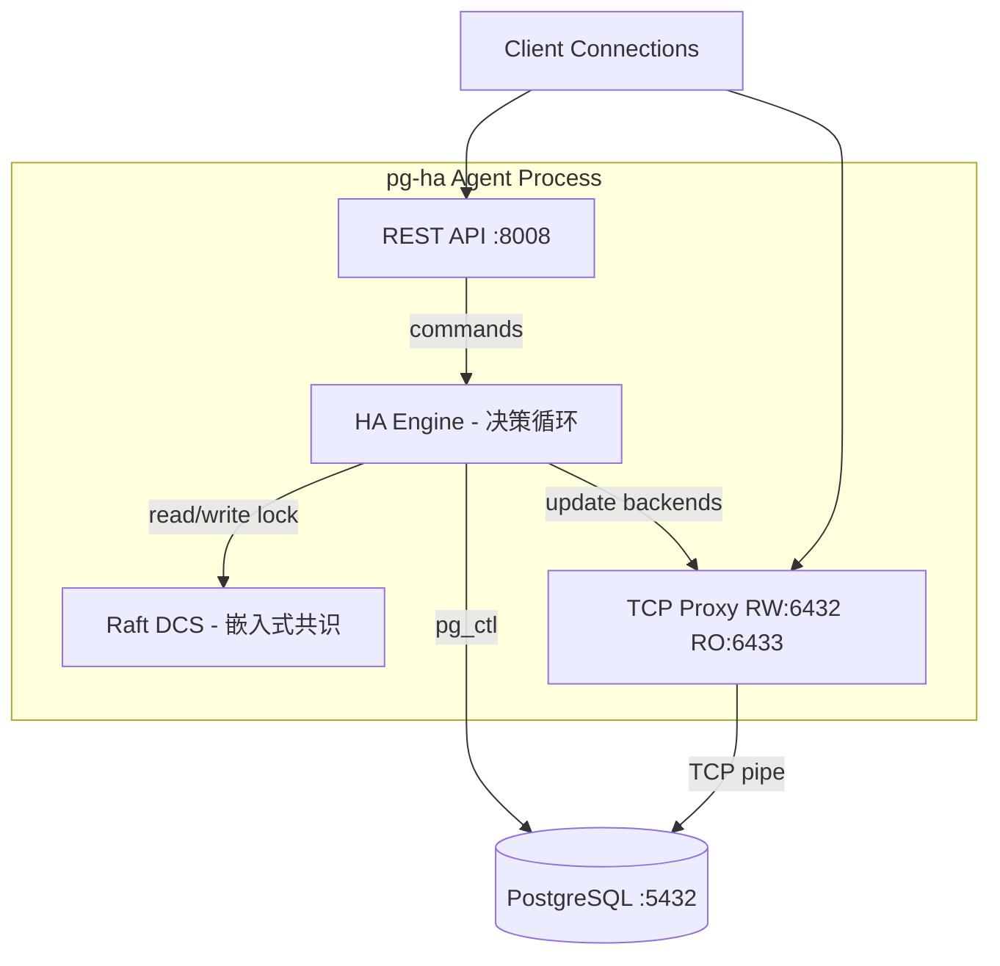

## HA 决策循环 (run_cycle)

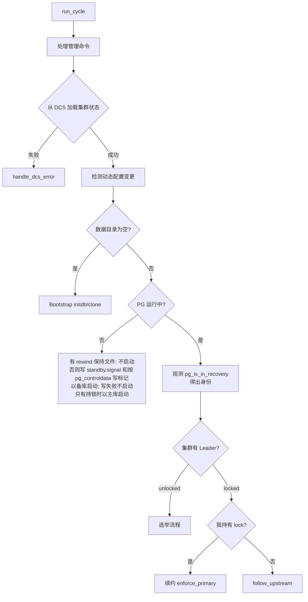

之后的每个分支都按身份（Primary / ManagedStandby / UnmanagedRecovery / Unknown）决策，不依据内存里记录的 role。完整决策表见 [invariants.md](invariants.md) 1a 节。

**时间界**：
- 主循环每 `loop_wait` 秒启动一轮；一轮超时后下一轮立即开始，错过的 tick 不连发（`MissedTickBehavior::Delay`）。
- 每次 DCS 写最多等 `retry_timeout` 秒，超时按写失败处理（openraft 0.9 的 Raft leader 失去多数派后不退位，不设上限时续锁会一直挂到网络恢复）。
- 持锁节点维护 leader 租约：每次抢锁 / 续锁开始前记录锚点（单调时钟和墙钟），成功后截止时间 = 锚点 + 写入锁的 TTL − `watchdog.safety_margin`。每轮周期与这个截止时间赛跑（`Ha::run_cycle_bounded`）：截止时间先到就放弃本轮，先写 `standby.signal` 和 rewind 检查标记，再 `pg_ctl stop -m immediate`。`pg_ctl promote` 之前和保持主之前也检查租约。pause 下不围栏。
- 参数约束 `ttl >= loop_wait + retry_timeout + safety_margin` 保证健康的主库能在租约内完成一轮周期和一次续锁。完整规则见 [invariants.md](invariants.md) L5 与 1a「leader 租约」。

## 选举流程 (process_unhealthy_cluster)

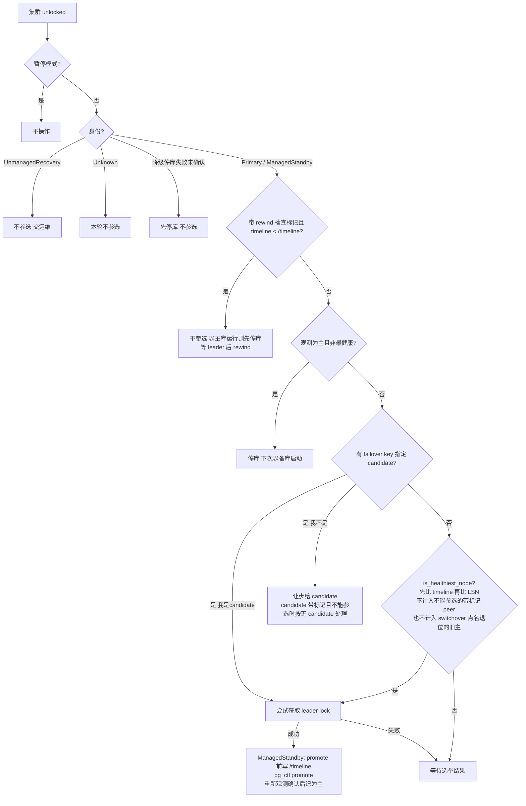

带 rewind 检查标记的节点能否参选、`/timeline` 的写入时机见 [invariants.md](invariants.md) 1a「集群 timeline 记录」。

## Failover + Rejoin 完整流程

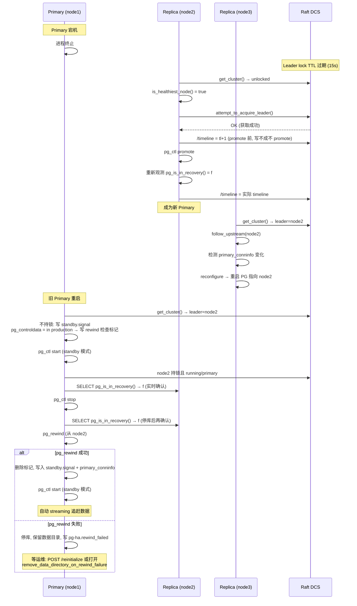

## 动态配置流程

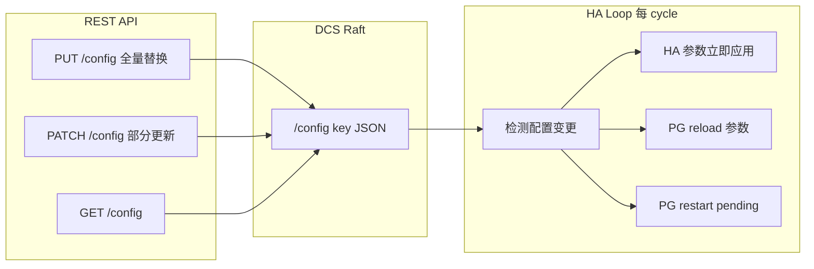

## TCP Proxy 健康检查

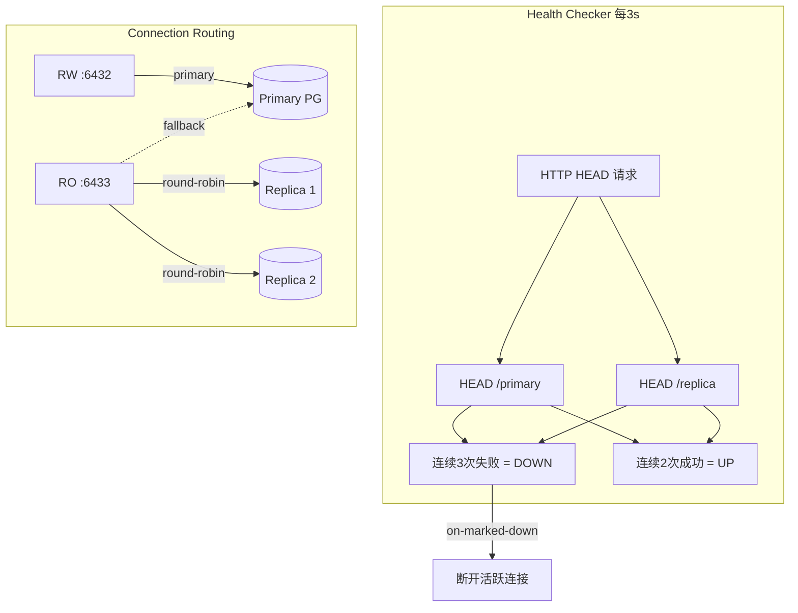

## Raft 共识层

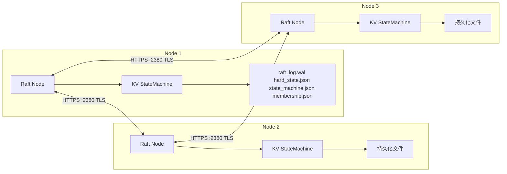

## DCS KV 存储结构

```
/service/{scope}/
├── leader          → "node1"              (TTL=15s, CAS 原子操作)
├── members/
│   ├── node1       → {conn_url, api_url, state, role, wal_position, timeline, rewind_check}  (TTL)
│   ├── node2       → {conn_url, api_url, state, role, wal_position, timeline, rewind_check}  (TTL)
│   └── node3       → {conn_url, api_url, state, role, wal_position, timeline, rewind_check}  (TTL)
├── timeline        → "3"                  (无 TTL, 单调不减, 持锁主写)
├── initialize      → "system_id"          (原子创建, 初始化竞争)
├── config          → {loop_wait, ttl, synchronous_mode, postgresql: {...}}
├── failover        → {leader, candidate}  (switchover 请求)
├── sync            → {leader, sync_standby, quorum}
├── failsafe        → {node1: api_url, ...}
└── history         → [{timestamp, event_type, old_leader, new_leader}]
```

## 同步复制数据流

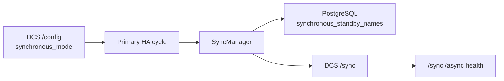

Primary 在持有 Leader Lock 时读取动态配置：

- `synchronous_mode=false`（默认）：清空 `synchronous_standby_names`，写空 `/sync`
- `synchronous_mode=true`：按 `sync_priority` / `nosync` 选出同步备库，设置 `FIRST N (...)`，并写入 `/sync`

目标值未变化时跳过重复 `ALTER SYSTEM` + reload。`/sync`、`/async` 健康检查读取 `/sync.sync_standby` 判断节点角色。

当前范围：同步复制配置与状态发布已实现；Failover / Switchover 在 `synchronous_mode` 启用时强制候选节点属于 DCS `/sync.sync_standby`（S5）。Quorum 模式下的选举/切换约束尚未实现。

## 模块依赖关系

```
pg-ha (binary)
├── pg-ha-core      HA 引擎 + PG 生命周期 + 配置 + 类型
│   ├── ha/             决策循环 (mod / election / commands / …)
│   ├── postgresql.rs   pg_ctl start/stop/promote/rewind/reload
│   ├── bootstrap.rs    initdb / clone / custom bootstrap
│   ├── dynamic_config.rs  GlobalConfig + 变更检测 + patch
│   ├── failsafe.rs     DCS 故障时的安全模式
│   ├── slots.rs        复制槽管理
│   ├── sync.rs         同步复制管理
│   ├── cascading.rs    级联复制
│   ├── standby_cluster.rs  备库集群
│   ├── watchdog.rs     硬件看门狗
│   ├── callbacks.rs    事件回调
│   └── history.rs      集群历史
├── pg-ha-dcs       Raft 共识 + KV 状态机
│   ├── raft_dcs.rs     DcsAdapter 实现
│   ├── store.rs        Raft 存储 (持久化)
│   ├── state_machine.rs KV + TTL + CAS
│   └── raft_server.rs  HTTP RPC
├── pg-ha-api       REST API (axum)
│   ├── routes/         健康检查 + 管理端点 + /metrics
│   └── state.rs        共享状态 (AppState)
├── pg-ha-proxy     TCP 负载均衡
│   └── proxy.rs        RW/RO 路由 + 主动健康检查
└── pg-ha-ctl       CLI 工具 (clap + reqwest)
```


## TLS 加密通信

Raft RPC 层使用 TLS 加密所有节点间通信，防止集群共识数据在网络上被窃取或篡改。REST API 端口保持 HTTP，仅在内部网络暴露。

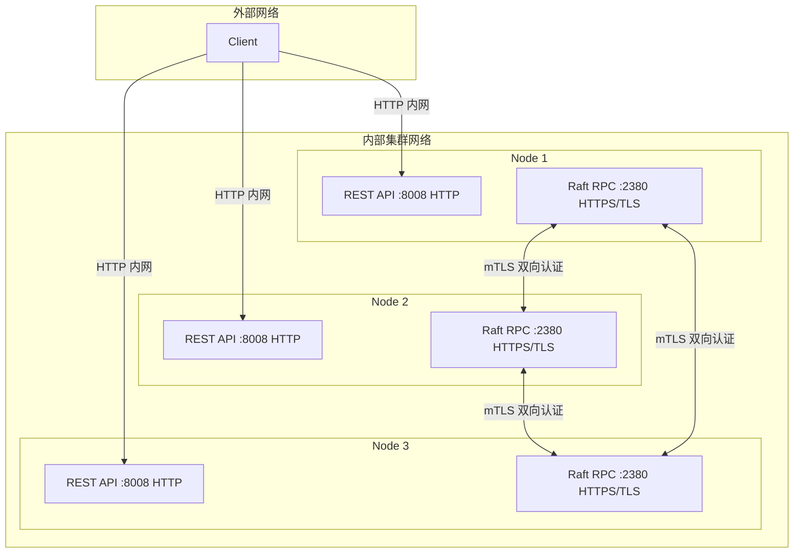

**TLS 配置要点：**

| 组件 | 端口 | 协议 | 说明 |
|------|------|------|------|
| Raft RPC | 2380 | HTTPS (TLS 1.2+) | 节点间共识通信，支持 mTLS |
| REST API | 8008 | HTTP | 内网管理端点，依赖网络隔离 |
| PostgreSQL | 5432 | TCP | PG 原生协议，可独立配置 `ssl` |
| Proxy RW/RO | 6432/6433 | TCP | 透传 PG 连接 |

- Raft RPC 启用 TLS 后，所有 `AppendEntries`、`RequestVote`、`InstallSnapshot` RPC 均通过加密通道传输
- mTLS（双向 TLS）可选启用：每个节点同时验证对端证书，防止未授权节点加入集群
- REST API 保持 HTTP 是因为它仅在内部网络暴露，由 Basic Auth 保护管理端点

## 认证与安全

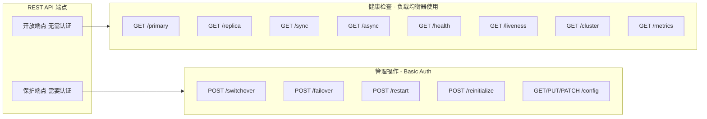

**认证机制：**

- **Basic Auth**：配置 `restapi.username` 和 `restapi.password` 后自动启用
- 认证未配置时，所有端点开放（适用于完全隔离的内网环境）
- 健康检查端点始终开放，供负载均衡器和 TCP Proxy 健康探测使用
- 管理端点（switchover、failover、config 变更等）受 Basic Auth 保护

```yaml
# 配置示例
restapi:
  listen: 0.0.0.0
  port: 8008
  username: admin      # 设置后启用 Basic Auth
  password: s3cr3t     # 管理端点需要此凭证
```

**请求示例：**

```bash
# 健康检查（无需认证）
curl http://localhost:8008/health
curl http://localhost:8008/primary
curl http://localhost:8008/replica

# 管理操作（需要 Basic Auth）
curl -u admin:s3cr3t -X POST http://localhost:8008/switchover \
  -H 'Content-Type: application/json' \
  -d '{"leader": "node1", "candidate": "node2"}'

# 未认证会返回 401
curl -X POST http://localhost:8008/failover
# → {"error": "Unauthorized"}
```

## 优雅关停流程

pg-ha 收到第一个 `SIGTERM` 或 `SIGINT` 后调用 `Ha::graceful_shutdown`（`crates/pg-ha-core/src/ha/shutdown.rs`，`src/main.rs` 只调用它）。规则：drain 期间续锁；CHECKPOINT + 停库受 leader 租约限制；停库之后才释放锁；PostgreSQL 还可能可写时绝不带着锁退出。

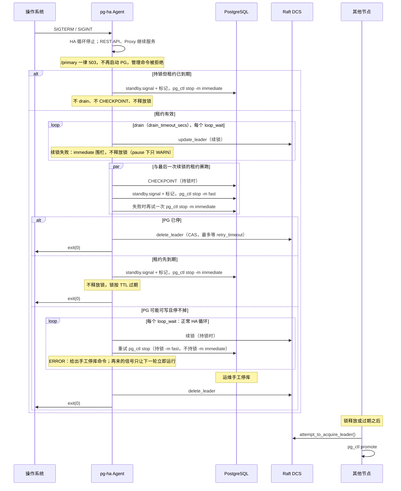

**关键设计决策：**

1. **停库之后才释放锁**：锁一直在本节点手里，直到确认 PostgreSQL 已停。先删锁会让别的节点在本节点还可写时 promote。
2. **drain 期间续锁**：`drain_timeout_secs`（默认 30 秒）长于默认租约（25 秒），不续锁的话锁会在 drain 期间过期。续锁失败就按失去锁围栏（pause 下除外，W1）。
3. **收尾受租约限制**：最后一次续锁在 drain 结束时，它的租约（`ttl − safety_margin`）限住 CHECKPOINT 和停库，赛跑方式与 `run_cycle_bounded` 相同。截止时间先到就按租约到期围栏，不释放锁，所以锁过期、别的节点 promote 之前本节点已经不可写（L5 时间界）。
4. **fast，失败再 immediate**：`-m fast` 断开客户端、做关机检查点；它失败且 PG 还在跑时再试一次 `-m immediate`。两次都在租约赛跑之内。
5. **停不掉就不退出**：退出后锁会过期，没人再围栏这台可能可写的 PostgreSQL。pg-ha 继续跑正常 HA 循环（续锁、按 `stop_pending` 每轮重试停库），每轮 ERROR 给出手工停库命令，确认停库后再释放锁退出。再收到 SIGTERM / SIGINT 也不退出。观测在 recovery 的 PostgreSQL 也算可能可写，除非它不持锁且有 `standby.signal`：持锁的 recovery（pg-ha 会 promote 它）和没有 `standby.signal` 的 recovery（`recovery.signal`，结束时自己 promote）停不掉时同样不退出，HA 循环只重试停库，不 promote；关停中不持锁时每轮只再 `-m immediate` 停库，不参选、不跟随。只有不持锁、有 `standby.signal` 的备库停不掉时记 ERROR 后退出。REST API 由单独的任务服务，这段时间一直可用，`/primary` 保持 503。
6. **SIGKILL 不在覆盖范围内**：systemd `TimeoutStopSec` 或 `docker stop -t` 到期后 pg-ha 被杀，上述规则无法执行，所以超时必须大于 drain + CHECKPOINT + 停库的时间（见运维指南）。停主库前先 switchover。

**时间线（默认配置；docker 开发集群 `ttl` 15、`loop_wait` 5）：**

| 阶段 | 耗时 | 说明 |
|------|------|------|
| 信号 | < 1ms | HA 循环停止，`/primary` 变 503 |
| drain | `drain_timeout_secs`（30s） | 只等待，每个 `loop_wait` 续锁 |
| CHECKPOINT + 停库 | 通常数秒，上限 `ttl − safety_margin`（25s，docker 10s） | 超过上限即围栏 |
| 释放锁 | ≤ `retry_timeout` | 只在停库之后 |
| 故障转移 | ≤ `loop_wait` + promote | 其他节点看到 unlocked 后选举、promote |
| **写不可用合计** | **约 30-45s** | 从信号到新 Primary 就绪；先 switchover 可避免 |

## 日志系统

pg-ha 使用 `tracing` + `tracing-subscriber` 提供 text/json 双模式日志输出。

**日志模式切换：**

| 环境变量 | 值 | 效果 |
|---------|---|------|
| `PG_HA_LOG_FORMAT` | `text`（默认） | 人类可读的彩色日志 |
| `PG_HA_LOG_FORMAT` | `json` | 结构化 JSON 日志（生产推荐） |
| `RUST_LOG` | tracing 过滤表达式 | 控制日志级别和模块过滤 |

**Text 模式示例（默认）：**

```
2024-01-15T10:30:00.123Z  INFO pg_ha: Starting pg-ha agent name="node1" scope="prod-cluster"
2024-01-15T10:30:02.456Z  INFO pg_ha_dcs: Raft cluster bootstrapped with 3 members
2024-01-15T10:30:05.789Z  INFO pg_ha_core::ha: run_cycle completed role=Primary leader=true
```

**JSON 模式示例（`PG_HA_LOG_FORMAT=json`）：**

```json
{"timestamp":"2024-01-15T10:30:00.123Z","level":"INFO","target":"pg_ha","message":"Starting pg-ha agent","name":"node1","scope":"prod-cluster"}
{"timestamp":"2024-01-15T10:30:02.456Z","level":"INFO","target":"pg_ha_dcs","message":"Raft cluster bootstrapped with 3 members"}
{"timestamp":"2024-01-15T10:30:05.789Z","level":"INFO","target":"pg_ha_core::ha","message":"run_cycle completed","role":"Primary","leader":true}
```

**RUST_LOG 环境变量控制：**

```bash
# 默认级别（内置）
RUST_LOG="pg_ha=info,openraft::replication=off"

# 调试 HA 决策循环
RUST_LOG="pg_ha_core::ha=debug,pg_ha=info"

# 调试 Raft 共识
RUST_LOG="pg_ha_dcs=debug,openraft=debug,pg_ha=info"

# 调试网络通信
RUST_LOG="pg_ha_dcs::network=trace,pg_ha=info"

# 全部 trace（大量输出，仅调试用）
RUST_LOG="trace"
```

**日志格式优先级：**

1. 环境变量 `PG_HA_LOG_FORMAT` 覆盖默认值
2. `RUST_LOG` 环境变量覆盖内置的过滤表达式
3. 内置默认：`pg_ha=info` + `openraft::replication=off`（抑制高频复制日志）
